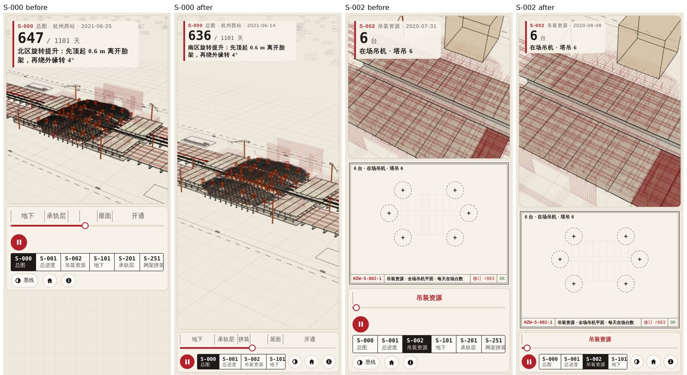
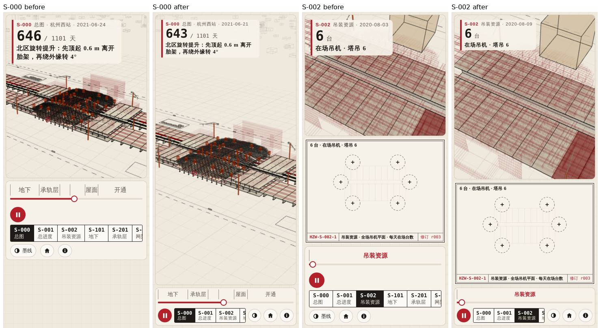
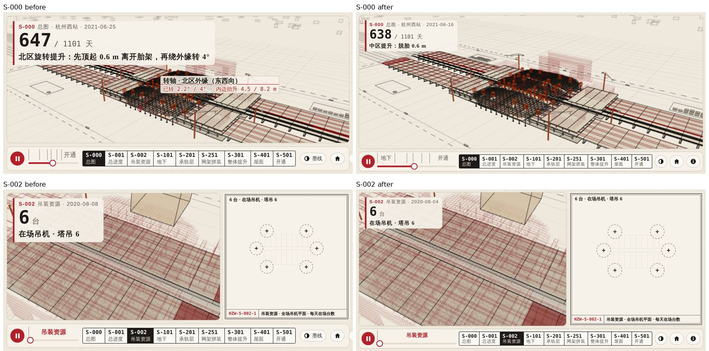

# 手机适配前后对比（D-27 · hark-darrio · 2026-11-08）

只改 `web/hzmobile.css`：竖屏 `@media (max-width: 820px) and (orientation: portrait)`，横屏 `@media (orientation: landscape) and (max-height: 500px)`（844×390 宽于 820，只能按高度判）。不改 id、不改 JS、不改 DOM。

**截图方法**：无头 Chromium（Playwright，SwiftShader），`is_mobile`、触屏、2 倍像素；`hzwest.html#sheet=<图号>&three=local`，等 `__pv.ready` 且出过 2 帧后再等 3 s 截。插件图取 S-002。时间点由页面自动播放决定，前后两张不是同一天，只比布局。

## 量出来的（CSS 像素，`getBoundingClientRect`）

| 视口 | 图 | 三维高 改前 → 改后 | 占屏 | 图纸高 | 控制条高 | 页面宽 |
|---|---|---|---|---|---|---|
| 390×844 | S-000 | 439 → 732 | 52% → 87% | — | 196（栏 381）→ 94 | 390 |
| 390×844 | S-002 | 334 → 447 | 40% → 53% | 290 → 279 | 196 → 94 | 390 |
| 360×780 | S-000 | 404 → 668 | 52% → 86% | — | 196（栏 352）→ 94 | 360 |
| 360×780 | S-002 | 300 → 407 | 38% → 52% | 260 → 255 | 196 → 94 | 360 |
| 844×390 | S-000 | 308 → 324 | 79% → 83% | — | 58 → 48 | 844 |
| 844×390 | S-002 | 三维 516 宽 / 图纸 304 宽 → 502 / 324 | 左右分栏 | 308 → 324 | 58 → 48 | 844 |

页面宽 = `scrollWidth`，各视口都等于视口宽，无页面级横向滚动。

## 改了什么
- **竖屏**：网格行 1.6 : 1 : 自动，三维在上、图纸紧随；S-000 没有图纸，控制条直接贴三维下方（改前中间空着一大块）。
- **控制条两行**：第一行时间轴（阶段段高 24、字 13）；第二行 播放 + 页签（横向滑动，隐藏滚动条）+ 墨线/复位/说明三个图标钮（墨线钮只留图标，title 仍在）。196 → 94。
- **大数字卡**收小（数字 30、说明 13），不再盖住三维上三分之一。
- **横屏**：三维 : 图纸 = 1.55 : 1；控制条一行，页签最宽 58% 可滑动。改前「说明」钮被挤出屏外，改后三个钮都在屏内。
- **说明面板**在手机上贴边铺满（上下左右 6 px）。

## 截图（左起：S-000 改前、改后、S-002 改前、改后）

## 没做的 / 要提醒的
- 三维画框高了以后，S-000 自动镜头仍按原比例取景，结构偏在画面中部；要更满需在 hzview.js 里按画框比例调镜头（宿主，不在本单范围）。
- `body.port` 等内联规则由 hzview.js 按 `W < 700 && H > W` 加，这里的 media query 与之叠加不冲突；平板竖屏（≤ 820 宽）同样走竖屏布局。
- 远端另有 `agent/hark-fangyi/D-27-mobile`（改 hzview.js / hzwest.html）。本单按派单只动 hzmobile.css，两者取哪个请 hark-cr 定。
