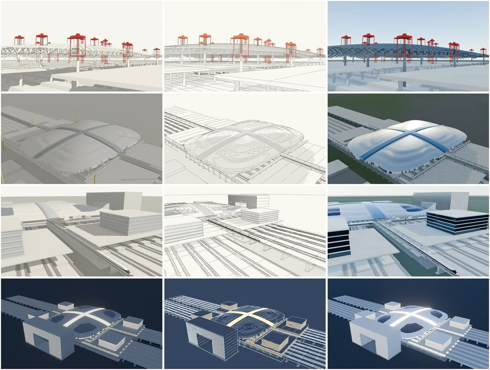

# 终版精修二版审计（杭州西站 · Blender · hark-cs）

- 执行：hark-cs（脚本 blender/v2/，Mac mini M4 · Blender 5.2.2 LTS · EEVEE，1920×1080）
- 评分：**Gemini 4 Argon**（Mac `~/tv-hub/tools/gemini4`，一次 1 张、JPEG ≤300 KB），12 张 × 最多 5 轮全部机评；muse 一版 12 张也用同一评分器、同一提示补评一次，便于对比（muse 文档里的 9.0/8.0/7.5/9.0 是指挥官目视分，口径不同，不直接比）
- 维度：构图 3 / 主体可读 3 / 质感光线 2 / 贴合墨线语言 2（满分 10）
- 全尺寸图：Mac `~/blender-v2/out/<轮次>/`（r1–r5 正式轮、c1–c15 候选机位、p0/t2/t3 试渲；每轮另有 scores.jsonl 与 *.log），不入仓
- 缩略图：`docs/audit/img/2026-11-09-blender-final-v2/`（overview 4×3 总览、四镜头墨线版各 1、muse 一版总览）

（总览与 lift_ink / night_ink 缩略图已换成三版定稿；roof_ink / train_ink 缩略图三版未变。）

## 与一版的根本区别：几何

一版（blender/build_final.py）用 export_geometry.js 导出的盒子近似：屋面是平的格子、列车是 8 节简模、提升器是方块。
二版直接导出页面同一份三角网格与墨线（`export_v2.js`：Geo.P / Geo.L），所以：

| | muse 一版 | 二版 |
|---|---|---|
| 屋面 | 平格子，四朵云不存在 | 当前 main 的 Hc（含 HZ.Wv 四朵云 +3.5 m、十字云缝） |
| 列车 | 8 节简模 | HZ.makeTrain 复兴号车头（shape-freeze 定型，25 m×8） |
| 提升 | t=643 盒子，提升器方块 | t=661（wlift 659–663 中点，四区同步 dy=-2.6 m，柱头未连），钢网架杆件、32 台红色提升器 |
| 范围 | 全站常显 | 同页面 SCOPE_OUT='hide'：不服务本镜头的临时构件（塔吊等）不导出 |
| 墨线 | 后加边线 | 页面 Geo.L 墨线 + Hc 2 m 等高线 + Wv 0.5 m 云纹线 |

## 分数（Gemini 4 Argon，同评分器）

| 镜头 · 风格 | muse 一版 | r1 | r2 | r3 | r4 | r5 | 二版定稿（取轮） |
|---|---|---|---|---|---|---|---|
| S-301 提升 · 白模 | 3.0 | 4.5 | 3.0 | 5.0 | 5.0 | – | **5.0**（r4） |
| S-301 提升 · 墨线 | 4.0 | 4.0 | 4.5 | 6.5 | 6.5 | – | **6.5**（r4） |
| S-301 提升 · 实景 | 3.5 | 4.0 | 3.5 | 4.0 | 4.0 | – | **4.0**（r4） |
| S-401 屋面 · 白模 | 3.5 | 5 | 5.0 | 4 | – | – | **5.0**（r2） |
| S-401 屋面 · 墨线 | 4.5 | 5.0 | 6.5 | 6.0 | 6.5 | – | **6.5**（r4） |
| S-401 屋面 · 实景 | 4.0 | 4.5 | 4.5 | 5.0 | 5 | – | **5.0**（r4） |
| S-501 列车 · 白模 | 3.0 | 4.0 | 3.0 | 4.0 | 4.5 | 4.5 | **4.5**（r5） |
| S-501 列车 · 墨线 | 5.0 | 5.5 | 6.5 | 5.5 | – | 6.5 | **6.5**（r5） |
| S-501 列车 · 实景 | 2.0 | 4.0 | 4.0 | 4.0 | 4.0 | 4.0 | **4.0**（r5） |
| 夜景 · 白模 | 4.5 | 4.5 | 4.5 | 4.5 | 5.0 | – | **5.0**（r4） |
| 夜景 · 墨线 | 6.0 | 6.0 | 6.0 | 6.5 | 5.0 | – | **6.5**（r3） |
| 夜景 · 实景 | 4.5 | 4 | 4.5 | 4.5 | 5.0 | – | **5.0**（r4） |
| **合计 / 120** | **47.5** | 55.0 | 55.5 | 59.5 | — | — | **63.5** |

「–」= 该轮未重渲（上轮已到平台或已达 5 轮）。停止规则：每张最多 5 轮、分数不升即停；r4 后除列车外全部停，列车 r5 到 5 轮上限。
注意：渲染脚本是共用的，r4 的全局改动（白模 Standard、夜景自发光降档）让 roof_clay、night_ink 不如更早轮，定稿取各自最高那轮的图；脚本当前状态复现的是 r4/r5 版本，roof_clay 要回 r2、night_ink 要回 r3 的参数（git 历史可查）。

## 逐镜头对比

### S-301 整体提升中段 — 5.0 / 6.5 / 4.0（一版 3.0 / 4.0 / 3.5）
- 改进：一版是「实心盒子 + 方块提升器」，Gemini 三张都扣「像水泥板、看不出钢网架」；二版是真网架杆件 + 32 台红色提升器，r3 拉近东南角、r4 机位降到 24 m 楼板与屋盖之间，墨线版到 6.5。
- 剩余：①没有钢绞线（页面也没有这层几何），屋盖「像自己飘着」；②柱头与网架下弦 2.6 m 脱空在 1080p 下不显眼；③实景版仍是白模 + 红块质感（材质无贴图），停在 4.0。

### S-401 屋面合拢 — 5.0 / 6.5 / 5.0（一版 3.5 / 4.5 / 4.0）
- 改进：一版屋面是平的，Gemini 直接扣「看不出四朵云」；二版四朵云与十字云缝清楚，侧逆光 7° 掠射读得出拱起，墨线版的等高线就是页面同一套。
- 剩余：Gemini 认为 2 m 等高线「像地形图」，建议改成顺板缝的细线 + 墨晕；云缝在实景版仍偏实色条。

### S-501 首趟列车驶出云门（列车与云门同框）— 4.5 / 6.5 / 4.0（一版 3.0 / 5.0 / 2.0）
- 改进：**列车与云门同框**——一版云门未入框（一版的已知短板）；二版射线核查（render_v2.py 打印 FRAMECHECK）列车入框 1.00 / 可见 0.92，云门入框 1.00 / 可见 0.68；列车是复兴号车头。
- 结构性限制（如实）：页面的停靠位 x=109.5 在屋盖下，四角上盖开发 47 m 体量把云门挡在后面，**列车停靠位上任何机位都不能同框**；所以取页面同一进站曲线 f=0.64（鼻尖 x=-59.4 刚进屋盖、尾部在露天），这是「进/出站途中」而不是「停在门口」。
- 剩余：①Gemini 连续 5 轮把方向读成「车头背离站房」并扣分——它按「驶向站房」理解；任务口径是「驶出云门」，这条扣分与口径相反，没按它掉头；②云门有约 1/3 被裙房遮挡、列车在画面里偏小；③实景版平灰，停在 4.0。

### 夜景亮灯全景 — 5.0 / 6.5 / 5.0（一版 4.5 / 6.0 / 4.5）
- 改进：抬高偏南机位，云门不再以黑侧面挡站房；十字云缝发光、四朵云轮廓、云门门洞同框；不再有施工机具（一版被扣「开通后还留着塔吊」）。
- 剩余：自发光是平涂色块，Gemini 要求暖白透光 + 轻微辉光（Bloom）与幕墙竖向分格。

## 对页面墨线语言的建议

1. **墨线版每个镜头都是三种风格里最高（6.5×4）**：页面现有的 Geo.L + 纸色底已经是最受认可的风格，宣传/结尾图优先用墨线版，不必追「实景」。
2. 屋面等高线 2 m 在远景偏密、像地形图：建议远景只留 0.5 m 云纹外圈 + 云缝两侧加深墨线，等高线间距放到 ≥2.5 m 或按距离淡出（S-401 作者文件内可做）。
3. 提升段补「钢绞线」几条竖向细墨线（每台提升器 1 条即可），屋盖悬空才读得出（需宿主几何，见 CLAIMS 接口请求）。
4. 夜景墨线版把发光十字做成「暖黄平涂 + 外圈 1 px 亮线」，比纯平涂更像灯。
5. 结尾镜头若要列车与云门同框，需要列车停在云门前露天段或换 S 侧机位——当前停靠位几何上做不到（同上）。

## 迭代记录

- p0/t2/t3：管线打通、试渲；c1–c15：候选机位小图（主要是列车同框问题，15 组）。
- r1：12 张首轮。r2：lift 远景压低（塔吊挡镜）掉分，弃用；roof 东北 9° 光未升。r3：lift 拉近东南角提升点（墨线 4.5→6.5），roof 改西北 7° 侧逆光，train 整列入框，night 抬高偏南。
- r4：白模日景改 Standard 视图变换、云缝/幕墙浅灰、道床压暗；lift 机位降到楼板与屋盖之间；实景 clad 压高光。night_ink 因自发光降档掉分（6.5→5.0），定稿取 r3。
- r5：只重渲列车（geo t1131f64，鼻尖进屋盖 60 m），分数持平 → 到 5 轮上限，停。

## 再生方法

Mac：`~/blender-v2/m` 解出 blender/v2，`zsh blender/v2/geo.sh` 导出 4 份几何（t661 / t756 / t1131 / t1131f64），`zsh blender/v2/run.sh <轮次>` 出 12 张，`blender/v2/score.py` 逐张评分。单张 EEVEE 约 1 分钟内；两路 Blender 用 after.sh 串行排队。

## 耗时与问题

- 前一子线程（11-09 约 05:25–06:53 PST）完成管线、r1–r5 渲染与评分后会话中断（一次读图过多），本线程只做汇总、缩略图、文档与提交，未再渲染。
- Gemini 评分偶发 429/脚本异常（night_clay r4 日志里有一次异常，重试后有分）。
- 收件仓库 11-09 06:54 起 ls-remote 回 409，推送状态见提交说明 / 汇报。

## 三版（hark-cs，2026-11-09 07:11–08:00 PST，r6–r8）

只改 `blender/v2/render_v2.py`（不改 web/）。评分器、提示、维度同二版：**Gemini 4 Argon**（Mac `~/tv-hub/tools/gemini4`，一次 1 张 JPEG ≤300 KB），本轮 21 次评分全部机评、无 429。每张最多 3 轮，分数不升即回退。

| 镜头 · 风格 | 二版 | r6 | r7 | r8 | 三版定稿（来源） |
|---|---|---|---|---|---|
| S-301 提升 · 白模 | 5.0 | –¹ | – | 5.0 | **5.0**（r8，有钢绞线） |
| S-301 提升 · 墨线 | 6.5 | –¹ | 6.5 | 5.0 | **6.5**（r7） |
| S-301 提升 · 实景 | 4.0 | – | 4.0 | 4.0 | **4.0**（r8，钢绞线 + 深灰网架） |
| S-401 屋面 · 白模 | 5.0 | 4.5² | – | – | **5.0**（r2 参数，脚本已复现） |
| S-401 屋面 · 墨线 | 6.5 | 7.0³ | – | – | **7.0**（三版未改，同图重评） |
| S-401 屋面 · 实景 | 5.0 | 5.0 | 5.0 | 4.5 | **5.0**（r7） |
| S-501 列车 · 白模 | 4.5 | 5.0 | – | – | **5.0**（r6，拉近机位） |
| S-501 列车 · 墨线 | 6.5 | 5.0 | – | – | **6.5**（回退二版 r5 机位） |
| S-501 列车 · 实景 | 4.0 | 4.0 | – | 4.0 | **4.0**（r8，拉近机位） |
| 夜景 · 白模 | 5.0 | 4.5 | – | 4.5 | **5.0**（回退二版 r4） |
| 夜景 · 墨线 | 6.5 | 5.5 | 6.5 | – | **6.5**（r7，发光描边） |
| 夜景 · 实景 | 5.0 | 4.5 | 4.5 | 5.0 | **5.0**（r8，发光描边 + 夜空） |
| **合计 / 120** | **63.5** | | | | **64.5** |

¹ r6 的钢绞线有坐标 bug（BVH 用了物体局部坐标，南北颠倒，只出 6 组），未评分；r7 修好。
² r6 的 roof_clay 是用参数表复现的 r2 图，与 r2 定稿像素 MAE 0.003（同一张图），Gemini 给 4.5 / 二版给 5.0 —— **同图重评有 ±0.5 的波动**，三版的 ±0.5 变化都在这个噪声里。
³ roof_ink 代码三版没动，7.0 也属同图重评波动，不算改进。

### 改了什么

1. **提升段钢绞线**（目标 1）：红色提升器按位置聚成 32 组，每组顶部向下对网架杆件做 13×13 射线采样，取最高命中 = 上弦吊点，画 4 根竖向钢绞线（墨线版深墨、白模深灰、实景深钢色）。r7 起 Gemini 不再说「屋盖像自己飘着 / 缺吊索」，改为要求「加粗、交代吊点咬合」；但 r8 加粗 + 中间 8 台塔架（落在十字天窗缝上方，扩到 ±9 m 找缝边网架）补线后墨线版反而 5.0，所以墨线版定稿用 r7（24 组、细线），白模 / 实景用 r8（32 组）。
2. **实景材质**（目标 2，没达到 ≥6）：屋面铝镁锰立缝（Wave 凹凸 ≈4 m 周期 + 噪声粗糙度 + 各向异性）、采光顶 / 幕墙低粗糙金属反射天空、股道金属、混凝土与地面噪声混色、物理天空 + 曝光（日景 -0.7 / 提升 -1.0 档，夜景 +0.4、夜空提亮）、网架深灰金属。画面明显不再「死白 / 平灰」，但分数持平：三轮 Gemini 的扣分点都转到**几何本身**——屋面边缘锯齿 / 破面、构件简陋、「SketchUp 灰盒」——这是页面同源低模几何的上限，材质救不了。实景仍是 4.0–5.0。
3. **夜景发光**（目标 3）：采光顶格栅线（页面 Geo.L 同源）画成暖白高亮自发光描边 + 合成器 Glare。r6 阈值 0.85 让白墨线和底色一起泛白，墨线版 6.5→5.5；r7 阈值改 1.25（只让发光线和灯晕）后回到 6.5；实景 r8 回到 5.0。白模夜景两轮都 4.5，回退二版。剩余：Gemini 仍要求「室内透光 + 冷暖层次」与云门立面亮灯，属灯光设计 / 几何（云门竖向窗带）层面。
4. **S-501 列车**（目标 4）：试 8 组候选机位（c16 A–H，射线核查）。南侧 / 西南机位云门可见 0.84–0.91，但列车被上盖开发与站台雨棚挡到可见 0.00–0.43，不能用；最终用北西拉近机位 TRAIN3（列车约放大 1.6 倍，入框 0.91 / 可见 0.86，云门可见 0.68 不变）。白模 4.5→5.0；墨线版 6.5→5.0（被读成「驶离站房」）→ 墨线版回退二版机位；实景持平。**云门遮挡没能减少**：北侧任何机位都有 47 m 上盖体量挡在前面，南侧机位又挡列车。另：评分提示里 S-501 写的是「驶向站房」，与任务口径「驶出云门」不一致，Gemini 的方向扣分来自这条提示，未按它掉头。
5. **参数可复现**（目标 5）：`render_v2.py` 新增 TABLE（镜头 × 风格，`src` 注明来源轮次），12 张定稿全部由当前脚本直接出图，不再回退 git。已核对：lift_ink（r7）与 night_clay（r4）用当前脚本重渲与定稿 MAE = 0；roof_clay（r2）MAE 0.003。

### 还剩什么

- 实景版 ≥6 需要几何精度（屋面边缘收口、幕墙龙骨、站台细部），超出渲染脚本范围。
- 提升段「柱头与网架脱空 2.6 m」仍不显眼（Gemini 三版每轮都提），需要宿主几何（柱顶截断）或专门的近景机位。
- 列车与云门同框仍是二版说过的结构性限制：要么列车停在露天段，要么允许南侧机位只看到车头。
- 屋面墨线版仍被说「等高线像地形图」，属页面墨线语言（S-401 作者文件）。

### 耗时与问题

- 约 50 分钟：候选机位 8 张（每张 33–90 s，Freestyle 白模比预估慢）、r6 12 张 + r7 5 张 + r8 7 张 + 复现核查 2 张、评分 21 次。
- Tailscale 到 Mac 的中继 07:46 左右断了约 3 分钟，重启沙箱 tailscaled 后恢复。
- 收件仓库推送见提交说明 / 汇报。
