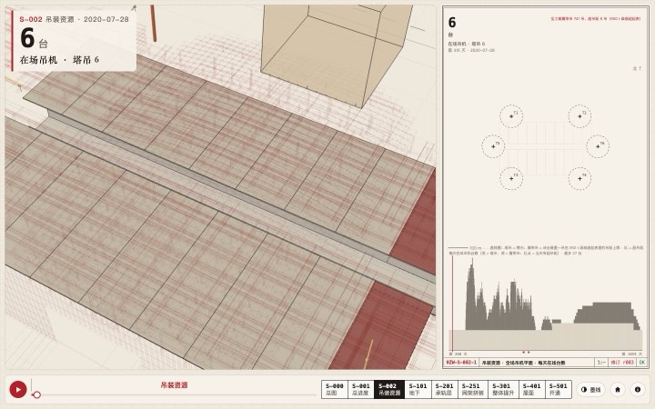
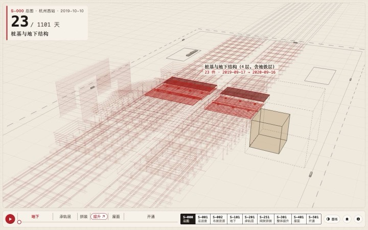
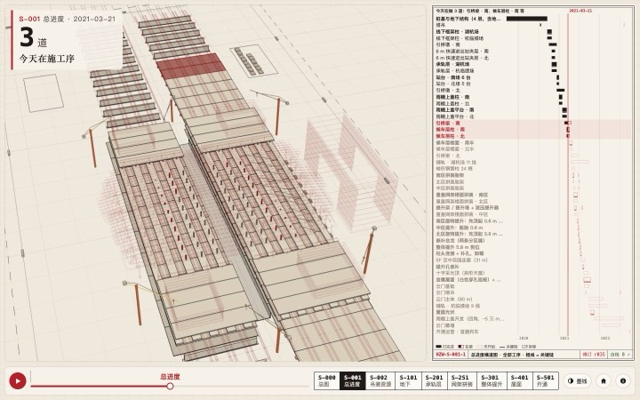
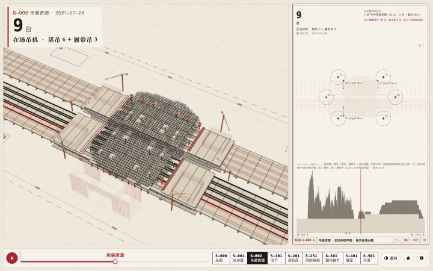
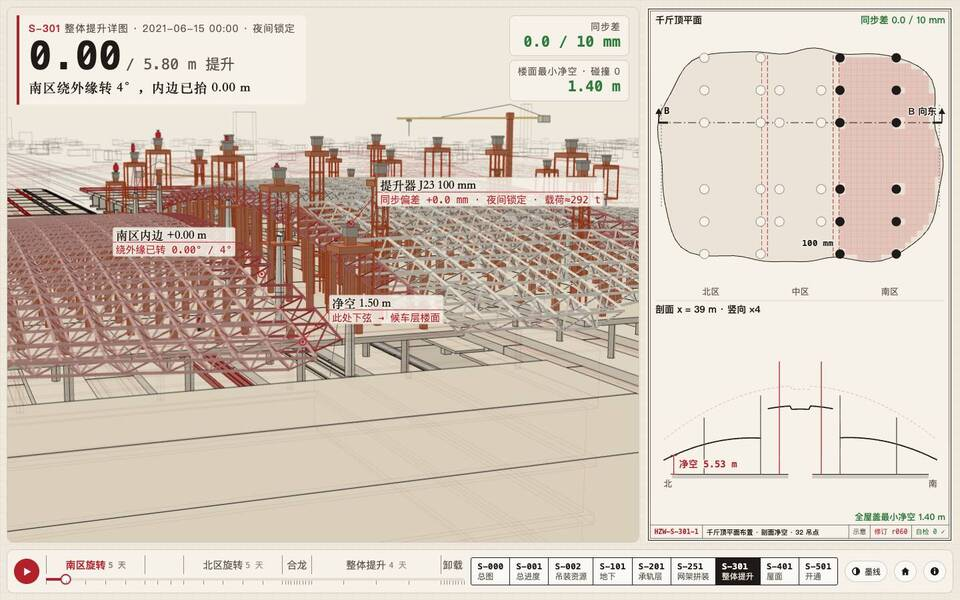
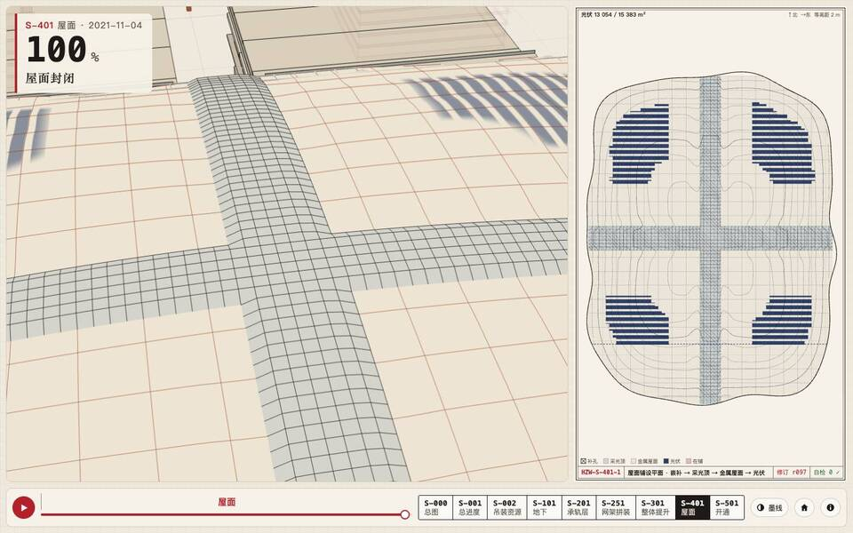

# 看图员试点：活图纸横屏三时刻 × Gemini 固定评分表（2026-11-09）

> 状态：**完成（27 / 27 张已评分）**。27 张截图全部截到（0 pageerror）。前 9 张（S-000、S-001、S-002）由 Gemini 4 打分；Gemini 自 2026-11-08 约 09:00 PST 起持续 429、Traycer 额度随后用完，后 18 张（S-101、S-201、S-251、S-301、S-401、S-501）由 hark-cs **人工看图**、按同一评分表补评（2026-11-08 晚）。
> 执行：Traycer（gemini-4-argon）截图与前 9 张打分脚本；hark-cs 汇总、人工抽查、补评 18 张并成文。只写文档，不改代码。
> **口径提醒**：后 18 张是人工评、口径偏严（前 9 张 Gemini 偏宽，见第 5 节，尤其 ③ 墨线项）。两批均分相差约 1.2 分，其中一部分是口径差，不全是图本身更差；横向比较时请按批看。

## 1. 方法

- 页面：`web/hzwest.html`，main `4490777`（本地 http 服务，Mac 无头 Chrome，`--use-angle=metal`）。
- 视口：横屏 1440×900，整页 JPEG q70。小屏/竖屏可读性不在本单范围（归 pi-t3）。
- 时刻：每张图取时间窗开头（t0 + 2% 窗长）、中段（中点）、末尾（t1 − 2% 窗长），取整天。插件图用 `window`；S-000 用宿主 `timeline`：[0, OPEN + 30] = [0, 1131]；S-301 用 [K.lift1.start, K.head.end] = [636, 671]。
- 本次 9 张图纸的时间窗与时刻：S-000 [0,1131]→23/566/1108；S-001 [0,1101]→22/551/1079；S-002 [300,1059]→315/680/1044；S-101 [0,365]→7/183/358；S-201 [365,900]→376/633/889；S-251 [594,641]→595/618/640；S-301 [636,671]→637/654/670；S-401 [679,781]→681/730/779；S-501 [700,1131]→709/916/1122。
- 模式：URL 不带 `mode`，即页面默认的**墨线**模式（注意：t > OPEN + 3 时墨线模式按设计过渡到 95% 实景，见 shape-freeze.md 第 7 节）。
- 截图方式：同一浏览器逐张打开；因 `hashchange` 不重读 `t=`，每张先跳 `about:blank` 再整页加载，等 `__pv.ready` + 3 秒。
- 打分：前 9 张用 Mac `~/tv-hub/tools/gemini4`（Gemini 4 Argon，经 Vertex 桥），温度 0.3，每张单独一次调用，串行。后 18 张由 hark-cs 直接看 1440×900 原图人工打分，同一五项、同一 1/5/10 锚点（第 4 节），每个问题对照代码定出处。
- 评分表措辞修正：任务书原稿写「左侧 2D、右侧三维」，与实际页面相反；已改为「左侧三维、右侧 2D 图纸（S-000 无右栏）、底部时间轴与页签」，五项内容不变，已评前 9 张全部用修正后的提示词。

## 2. 总表（27 张；前 9 张 Gemini 评，后 18 张人工评）

| 图 | t（天） | ①对应 | ②大数字 | ③墨线/无灰盒 | ④文字 | ⑤镜头 | 均分 | 链接 |
|---|---|---|---|---|---|---|---|---|
| S-000 总图 | 23 | 9 | 9 | 6 | 7 | 8 | 7.8 | [打开](../../web/hzwest.html#sheet=S-000&t=23&play=0) |
| S-000 总图 | 566 | 8 | 10 | 9 | 8 | 8 | 8.6 | [打开](../../web/hzwest.html#sheet=S-000&t=566&play=0) |
| S-000 总图 | 1108 | 8 | 9 | 6 | 9 | 10 | 8.4 | [打开](../../web/hzwest.html#sheet=S-000&t=1108&play=0) |
| S-001 总进度 | 22 | 8 | 9 | 5 | 7 | 7 | 7.2 | [打开](../../web/hzwest.html#sheet=S-001&t=22&play=0) |
| S-001 总进度 | 551 | 8 | 9 | 9 | 7 | 7 | 8.0 | [打开](../../web/hzwest.html#sheet=S-001&t=551&play=0) |
| S-001 总进度 | 1079 | 9 | 9 | 7 | 7 | 8 | 8.0 | [打开](../../web/hzwest.html#sheet=S-001&t=1079&play=0) |
| S-002 吊装资源 | 315 | 3 | 7 | 8 | 7 | 3 | 5.6 | [打开](../../web/hzwest.html#sheet=S-002&t=315&play=0) |
| S-002 吊装资源 | 680 | 8 | 8 | 9 | 7 | 9 | 8.2 | [打开](../../web/hzwest.html#sheet=S-002&t=680&play=0) |
| S-002 吊装资源 | 1044 | 7 | 7 | 8 | 7 | 9 | 7.6 | [打开](../../web/hzwest.html#sheet=S-002&t=1044&play=0) |
| S-101 地下 | 7 | 7 | 7 | 5 | 6 | 7 | 6.4 | [打开](../../web/hzwest.html#sheet=S-101&t=7&play=0) |
| S-101 地下 | 183 | 7 | 7 | 5 | 5 | 6 | 6.0 | [打开](../../web/hzwest.html#sheet=S-101&t=183&play=0) |
| S-101 地下 | 358 | 7 | 7 | 5 | 7 | 6 | 6.4 | [打开](../../web/hzwest.html#sheet=S-101&t=358&play=0) |
| S-201 承轨层 | 376 | 7 | 8 | 5 | 5 | 7 | 6.4 | [打开](../../web/hzwest.html#sheet=S-201&t=376&play=0) |
| S-201 承轨层 | 633 | 7 | 9 | 7 | 5 | 6 | 6.8 | [打开](../../web/hzwest.html#sheet=S-201&t=633&play=0) |
| S-201 承轨层 | 889 | 5 | 9 | 7 | 5 | 6 | 6.4 | [打开](../../web/hzwest.html#sheet=S-201&t=889&play=0) |
| S-251 网架拼装 | 595 | 6 | 7 | 7 | 5 | 7 | 6.4 | [打开](../../web/hzwest.html#sheet=S-251&t=595&play=0) |
| S-251 网架拼装 | 618 | 7 | 7 | 6 | 4 | 7 | 6.2 | [打开](../../web/hzwest.html#sheet=S-251&t=618&play=0) |
| S-251 网架拼装 | 640 | 8 | 7 | 6 | 7 | 5 | 6.6 | [打开](../../web/hzwest.html#sheet=S-251&t=640&play=0) |
| S-301 整体提升 | 637 | 6 | 7 | 7 | 7 | 6 | 6.6 | [打开](../../web/hzwest.html#sheet=S-301&t=637&play=0) |
| S-301 整体提升 | 654 | 6 | 7 | 7 | 7 | 6 | 6.6 | [打开](../../web/hzwest.html#sheet=S-301&t=654&play=0) |
| S-301 整体提升 | 670 | 5 | 7 | 7 | 7 | 6 | 6.4 | [打开](../../web/hzwest.html#sheet=S-301&t=670&play=0) |
| S-401 屋面 | 681 | 6 | 8 | 7 | 6 | 6 | 6.6 | [打开](../../web/hzwest.html#sheet=S-401&t=681&play=0) |
| S-401 屋面 | 730 | 7 | 9 | 7 | 7 | 6 | 7.2 | [打开](../../web/hzwest.html#sheet=S-401&t=730&play=0) |
| S-401 屋面 | 779 | 5 | 8 | 5 | 7 | 4 | 5.8 | [打开](../../web/hzwest.html#sheet=S-401&t=779&play=0) |
| S-501 开通 | 709 | 8 | 7 | 7 | 6 | 7 | 7.0 | [打开](../../web/hzwest.html#sheet=S-501&t=709&play=0) |
| S-501 开通 | 916 | 8 | 7 | 5 | 6 | 8 | 6.8 | [打开](../../web/hzwest.html#sheet=S-501&t=916&play=0) |
| S-501 开通 | 1122 | 4 | 7 | 8 | 7 | 8 | 6.8 | [打开](../../web/hzwest.html#sheet=S-501&t=1122&play=0) |

| 图 | ① | ② | ③ | ④ | ⑤ | 均分 |
|---|---|---|---|---|---|---|
| S-000 | 8.3 | 9.3 | 7.0 | 8.0 | 8.7 | 8.3 |
| S-001 | 8.3 | 9.0 | 7.0 | 7.0 | 7.3 | 7.7 |
| S-002 | 6.0 | 7.3 | 8.3 | 7.0 | 7.0 | 7.1 |
| S-101 | 7.0 | 7.0 | 5.0 | 6.0 | 6.3 | 6.3 |
| S-201 | 6.3 | 8.7 | 6.3 | 5.0 | 6.3 | 6.5 |
| S-251 | 7.0 | 7.0 | 6.3 | 5.3 | 6.3 | 6.4 |
| S-301 | 5.7 | 7.0 | 7.0 | 7.0 | 6.0 | 6.5 |
| S-401 | 6.0 | 8.3 | 6.3 | 6.7 | 5.3 | 6.5 |
| S-501 | 6.7 | 7.0 | 6.7 | 6.3 | 7.7 | 6.9 |
| 前 9 张（Gemini） | 7.6 | 8.6 | 7.4 | 7.3 | 7.7 | 7.7 |
| 后 18 张（人工） | 6.4 | 7.5 | 6.3 | 6.1 | 6.3 | 6.5 |
| 全 27 张 | 6.8 | 7.9 | 6.7 | 6.5 | 6.8 | 6.9 |

后 18 张最低单张：S-401 t=779（5.8）、S-101 t=183（6.0）。五项里最弱的是 ④文字（6.1）与 ③墨线（6.3），最强的是 ②大数字（但常是「醒目却重复」，见第 3 节）。

页面错误：27 张截图 pageerror 合计 0，console error 合计 0。

## 3. 每张图最需要改的三条

前三张图：归属是 hark-cs 按代码判断的（Gemini 只分「三维 / 图纸 / 框架」）；标「未核实」的是 Gemini 说的、人工还没看过。后六张图：问题是 hark-cs 看图发现、出处对照代码定的；标「推测」的是出处没逐行核到。

### S-000 总图（均分 8.3）
1. **三维里有占位方块**：t=23 站房东侧一个半透明褐色实心立方体 + 虚线框（人工核实属实）；t=1108 配楼是条纹色块。归属：宿主场景（`web/hzseq.js` 构件 / `web/hzview.js` 渲染）。[t=23](../../web/hzwest.html#sheet=S-000&t=23&play=0) · [t=1108](../../web/hzwest.html#sheet=S-000&t=1108&play=0)
2. **开通后读数与画面对不上**：t=1108 左上写「首趟列车进站」，三维里没有车；中央「推演完成」浮框压在站房上（未核实）。归属：宿主 `web/hzview.js`（总图读数与收尾浮框）。[t=1108](../../web/hzwest.html#sheet=S-000&t=1108&play=0)
3. **时间轴阶段与读数偏差**：t=566 滑块在「承轨层」段，读数已在讲高架候车层（未核实）。归属：宿主 `web/hzview.js` 时间轴分段。[t=566](../../web/hzwest.html#sheet=S-000&t=566&play=0)

### S-001 总进度（均分 7.7）
1. **横道图工序名被省略号截断、约 50 行字太小**：三个时刻都被点到（人工核实属实，如「桩基与地下结构（4 层，含地…」）。归属：`web/sheets/s001.js`（名称栏宽与行高）。[t=551](../../web/hzwest.html#sheet=S-001&t=551&play=0)
2. **镜头偏紧、裁边**：t=22 在施红色高亮贴左边被裁；t=551 南北端头出画。归属：`web/sheets/s001.js` 的 `cam` 关键帧（宿主按它取景）。[t=22](../../web/hzwest.html#sheet=S-001&t=22&play=0)
3. **灰盒子**：t=22 半空悬浮立方体；t=1079 采光顶下深灰矩形块（未核实）。归属：宿主场景（`web/hzseq.js` / `web/hzview.js`）。[t=1079](../../web/hzwest.html#sheet=S-001&t=1079&play=0)

### S-002 吊装资源（均分 7.1，全场最低一张 5.6）
1. **t=315 镜头太近，6 台塔吊全在画外**，三维与右侧吊机平面对不上（①3、⑤3；人工核实属实，画面只剩楼板和顶部一个褐色占位方块）。归属：`web/sheets/s002.js` 的 `cam`。[t=315](../../web/hzwest.html#sheet=S-002&t=315&play=0)
2. **大数字重复**：左上浮层与右侧图纸左上角同时出现「6 台 / 9 台 / 8 台」及同一副标题，一屏两个主数字（人工核实属实）。归属：`web/sheets/s002.js` 的 `draw`（图纸内大数字）与宿主浮层 `big(t)` 的分工。[t=680](../../web/hzwest.html#sheet=S-002&t=680&play=0)
3. **三维吊机不显眼、图例字小**：吊机线条细、没有编号和作业半径圈；图纸中部图例长句字小，t=1044「42 m」断行（未核实）。归属：`web/sheets/s002.js`（图例排版），三维标注归宿主 `web/hzview.js`。[t=1044](../../web/hzwest.html#sheet=S-002&t=1044&play=0)

### S-101 地下（均分 6.3，人工评）
1. **三维被「未建幽灵线」糊满**：墨线模式把整座站房未来所有构件画成淡红线框，地下阶段全屏都是红线，真正在挖的几块坑反而不突出；另有一个半透明褐色实心方块（t=7 左上、t=358 左侧占半屏并出画），与 S-000 t=23 那块像是同一个。归属：宿主 `web/hzview.js`（第 163 行墨线着色：未建 = 设计位幽灵），褐色方块属宿主场景构件（`web/hzseq.js`，推测，未核出是哪一件）。[t=7](../../web/hzwest.html#sheet=S-101&t=7&play=0) · [t=358](../../web/hzwest.html#sheet=S-101&t=358&play=0)
2. **大数字一屏两份**：左上浮层「5 / 87.2 / 120 万 m³」与右侧图纸左上角同一数字、同一副标题重复（同 S-002）。归属：`web/sheets/s101.js` 第 365 行起图纸内 `big` 与宿主浮层 `hudBig`（`web/hzview.js` 第 763–768 行）分工。[t=183](../../web/hzwest.html#sheet=S-101&t=183&play=0)
3. **图纸小字断行、压线**：t=183 副标题「回筑 B2 板 −15.4」在图纸里断成「−15.」「4」两行；t=7「挖出的土 = 边长 37 m 的立方体」与「80 m（云门高）」两条标注挤在立方体上；t=7 下方剖面约 70% 是空白土色。归属：`web/sheets/s101.js`（第 357 行立方体标注、第 365 行起表头 wrap）。[t=183](../../web/hzwest.html#sheet=S-101&t=183&play=0) · [t=7](../../web/hzwest.html#sheet=S-101&t=7&play=0)

### S-201 承轨层（均分 6.5，人工评）
1. **图纸字太小、被线穿过**：平面图上「北 · 杭临绩场 8/9 线贯通」「南 · 湖杭场 11/11 线贯通」等标签约 7 px，且被股道线从中间穿过；整张平面是细长两条，左右大片留白。归属：`web/sheets/s201.js`（draw 里的标签与版面比例）。[t=889](../../web/hzwest.html#sheet=S-201&t=889&play=0) · [t=376](../../web/hzwest.html#sheet=S-201&t=376&play=0)
2. **三维标签没指到在做的东西**：t=889 浮签「铺轨 · 杭临绩场 9 线」的引线落在远处屋盖边上，不在股道上；正在铺的股道三维里几乎看不到红色。归属：宿主 `web/hzview.js` 第 1008 行（锚点取最近开工构件的 `top`，推测轨道构件 top 取值不合适）。[t=889](../../web/hzwest.html#sheet=S-201&t=889&play=0)
3. **镜头贴地，塔吊杆挡在画面正中**：t=633、t=889 低机位（el 4°）把一根塔吊立杆放在前景中央，竖穿整个画面；屋面光伏在远处成了模糊蓝条。归属：`web/sheets/s201.js` 第 252–258 行 `cam`（D-14 为避开雨棚压低到 4°）；光伏糊见 S-401 第 2 条。[t=633](../../web/hzwest.html#sheet=S-201&t=633&play=0)

### S-251 网架拼装（均分 6.4，人工评）
1. **图纸右上角小字互相压**：「公开对照」两行（05-31 拼装累计…/06-28 整体提升完成…）压到「北 ↑」和北区网格顶边上；「中区 0/11」贴在框线上。归属：`web/sheets/s251.js` 第 193 行起「公开对照」wrap。[t=618](../../web/hzwest.html#sheet=S-251&t=618&play=0)
2. **大数字一屏两份**：浮层与图纸左上同为「12 / 45 单元」「45 / 45」。归属：`web/sheets/s251.js` 图纸表头与宿主 `hudBig` 分工（同 S-002、S-101）。[t=640](../../web/hzwest.html#sheet=S-251&t=640&play=0)
3. **三维太密、屋盖出画**：t=618 前景一片橙色胎架竖杆，看不出「中区正在拼」哪一块；t=640 网架铺满全画面，下、左两边出画，看不到整体轮廓。归属：`web/sheets/s251.js` 第 214 行 `cams`。[t=618](../../web/hzwest.html#sheet=S-251&t=618&play=0) · [t=640](../../web/hzwest.html#sheet=S-251&t=640&play=0)

### S-301 整体提升（均分 6.5，人工评）
1. **一屏三个「净空」数字**：t=637 三维写「净空 1.50 m」，右上卡片「楼面最小净空 1.40 m」，图纸剖面「净空 5.53 m」（t=654：9.96 / 4.95 / 7.17；t=670：15.16 / 10.15 / 12.37）。三处量的是不同位置（南区内边一根下弦 / 全屋盖最小 / x = 39 m 剖面），但页面上没说清，看的人会以为数据打架。归属：宿主 `web/hzview.js` 第 328 行 `measureAt`（三维）与卡片、`web/hzsheet.js` 第 298、302 行（剖面）。[t=637](../../web/hzwest.html#sheet=S-301&t=637&play=0)
2. **镜头下半屏是空楼面**：三个时刻三维下方约 40% 是空的候车层楼面，主角网架挤在上半部。归属：宿主 `web/hzview.js`（S-301 镜头由宿主按 K.lift 关键帧取景，推测）。[t=654](../../web/hzwest.html#sheet=S-301&t=654&play=0)
3. **千斤顶平面不随过程变**：t=654 到 t=670（提升→卸载）右上平面图几乎一样，看不出哪组在动；剖面下半部大片空白。归属：`web/hzsheet.js` 第 186 行起 S-301-1。[t=670](../../web/hzwest.html#sheet=S-301&t=670&play=0)

### S-401 屋面（均分 6.5，人工评；单张最低 5.8）
1. **t=779 镜头太近**：只剩十字采光顶交点附近一块，屋面四边全部出画（⑤4）。归属：`web/sheets/s401.js` 第 277–282 行 `cam`，末帧 dist 170 太近。[t=779](../../web/hzwest.html#sheet=S-401&t=779&play=0)
2. **光伏在三维里是糊的蓝条**：屋面光伏边缘发虚，像拖影，和右侧图纸里清楚的蓝色条带对不上（S-201 t=889 远景同样）。归属：宿主 `web/hzview.js` 第 141–155 行着色器 `hzPVMask` / 条带 smoothstep（推测，是遮罩边缘过软或远处走样）。[t=779](../../web/hzwest.html#sheet=S-401&t=779&play=0)
3. **三维没标出「正在做的」**：t=681 图纸写「提升到位，等待补孔」，三维里补孔洞没有红色高亮；t=779 大数字 100% 屋面封闭，图纸却写光伏 13 054 / 15 383 m²（未完），两个数说的不是一件事又挨着。图纸小字约 7 px。归属：`web/sheets/s401.js`（`big` 第 272 行、`parts` 的当前工序标记）。[t=681](../../web/hzwest.html#sheet=S-401&t=681&play=0) · [t=779](../../web/hzwest.html#sheet=S-401&t=779&play=0)

### S-501 开通（均分 6.9，人工评）
1. **开通后画面与文字对不上**：t=1122 浮签「首趟列车进站」指向站台空处，画面里看不到车（同 S-000 t=1108）；顶部日期停在 2022-09-22，图纸却写「第 1122 天 · 2022-10-13」。归属：日期——宿主 `web/hzview.js` 第 763、773 行把日期钳在 OPEN，而 `web/sheets/s501.js` 第 174 行用真实 t；车——`web/sheets/s501.js` 第 45 行 `trainAt` 与 `camKeys`、宿主 `web/hzview.js` 第 1009 行锚点（车可能已出镜头或被站台挡住，未核实）。[t=1122](../../web/hzwest.html#sheet=S-501&t=1122&play=0)
2. **云门是实心色块**：t=916 三维里云门是一摞褐色实心板 + 红竖线，像体块模型，不是墨线。归属：宿主场景（`web/hzseq.js` 云门构件 / `web/hzview.js` 材质，推测）。[t=916](../../web/hzwest.html#sheet=S-501&t=916&play=0)
3. **大数字重复 + 图纸留白**：浮层与图纸都写「392 天」「G9528」；t=709 图纸下半「云门立面」框里几乎是空的。归属：`web/sheets/s501.js` 第 184–188 行与宿主 `hudBig`；第 165 行起云门立面。[t=709](../../web/hzwest.html#sheet=S-501&t=709&play=0)

## 3a. 全局：最该改的 5 条（27 张合看，按影响排序）

1. **画面和文字对不上**——看的人最先怀疑的就是这个。S-000 t=1108 / S-501 t=1122 写「首趟列车进站」却看不到车；S-501 顶部日期停在开通日、图纸写 21 天后；S-301 一屏三个不同的「净空」不加说明；S-201 浮签引线指到屋盖上。改法：同一屏只出现一个口径的数，不同位置的数写清「哪里」；车没入镜就别挂「进站」。出处：`web/hzview.js`（`hudBig`、第 1008–1009 行锚点、`measureAt`）、`web/sheets/s501.js`、`web/hzsheet.js`。[t=1122](../../web/hzwest.html#sheet=S-501&t=1122&play=0) · [t=637](../../web/hzwest.html#sheet=S-301&t=637&play=0)
2. **镜头取景**——太近、主体出画，或下半屏空地。S-002 t=315、S-401 t=779 主体基本出画；S-301 全程下 40% 空楼面；S-251 t=640、S-001 t=551 主体出边；S-201 低机位让塔吊杆竖穿画面。改法：各插件 `cam` 末帧拉远、抬高目标点，`tools/hz/check_cams.js` 加「主体包围盒在画面内 ≥ 90%」「下 1/3 不全是地面」两条检查。出处：`web/sheets/s002.js`、`s401.js`、`s251.js`、`s201.js`、`s001.js` 的 `cam`，S-301 归宿主。[t=779](../../web/hzwest.html#sheet=S-401&t=779&play=0) · [t=315](../../web/hzwest.html#sheet=S-002&t=315&play=0)
3. **图纸小字看不清、互相压**——④是五项里最低的（全 27 张 6.5）。S-001 横道名截断、S-201 标签被股道线穿过、S-251「公开对照」压北箭头、S-101「−15.4」断行。改法：图纸最小字号定到 ≥ 9 px（1440 宽下），标签统一走已有的避让 `label()`（S-501 已有，S-201/S-251 表头没走），表头副标题不断数字。出处：`web/sheets/s001.js`、`s201.js`、`s251.js`、`s101.js`。[t=618](../../web/hzwest.html#sheet=S-251&t=618&play=0)
4. **三维里的色块和杂线**——占位方块（S-000 t=23、S-101 左侧褐色块）、云门实心板（S-501 t=916）、光伏糊成蓝条（S-401、S-201）、地下阶段全屏未建幽灵红线（S-101、S-201 早期）。改法：先找出褐色方块是哪个构件并换墨线；幽灵线只画当前图相关的构件或再淡一档；光伏遮罩边缘收硬。出处：宿主 `web/hzview.js`（第 141–163 行着色）、`web/hzseq.js`（构件）。[t=358](../../web/hzwest.html#sheet=S-101&t=358&play=0) · [t=916](../../web/hzwest.html#sheet=S-501&t=916&play=0)
5. **大数字一屏两份**——S-002、S-101、S-251、S-501 的左上浮层和图纸左上角写同一个数、同一句副标题，各占一块，反而分散注意。改法：浮层留大数字，图纸表头改成只写图名 + 当日在做（或反过来），由宿主统一规定。出处：宿主 `web/hzview.js` 第 763–768 行 `hudBig` 与各插件 `draw` 表头。[t=640](../../web/hzwest.html#sheet=S-251&t=640&play=0) · [t=680](../../web/hzwest.html#sheet=S-002&t=680&play=0)

## 4. 证据核对评分表（可复用）

提示词原文（`{ID}`、`{名}`、`{T}` 按截图替换）：

> 这是一张施工过程『活图纸』网页截图：左侧是同一时刻的三维模型，右侧是 2D 图纸（S-000 总图无右侧图纸栏，仅全屏三维与左上读数），底部有时间轴和页签。图纸号 {ID}（{名}），时刻 t={T} 天。按下面五项各打 1–10 分：①图纸与三维是否讲同一件事（图上高亮/在施的内容三维里能对上；S-000 看左上读数/阶段条与三维在施内容是否对上）；②一屏一个大数字是否醒目（有没有一个最重要的数字一眼可见）；③墨线语言统一、没有灰盒子/占位方块；④文字可读，无遮挡、无溢出、无重叠；⑤三维镜头没有裁掉主体、没有钻到地面以下。再列出最大的 3 个问题（每条一句，说清在画面哪里，并判断问题出在左侧三维、右侧图纸还是页面框架）。最后一行严格写：分数: ①=a ②=b ③=c ④=d ⑤=e

每项的 1 / 5 / 10 分大致是：

| 项 | 1 分 | 5 分 | 10 分 |
|---|---|---|---|
| ① 图纸与三维讲同一件事 | 三维里看不到图纸在讲的构件 | 能对上但要找 | 图上高亮的东西三维里一眼就在 |
| ② 一屏一个大数字 | 没有主数字或好几个抢 | 有但不醒目 / 重复 | 一个数字一眼可见 |
| ③ 墨线语言、无灰盒子 | 大面积占位方块 | 个别灰盒子或色块 | 全是统一墨线 |
| ④ 文字可读 | 大量遮挡 / 溢出 | 个别截断或压线 | 全部清楚 |
| ⑤ 镜头 | 主体出画或钻地 | 主体被裁一部分 | 主体完整、构图稳 |

用作闭环「证据核对」时：改完一张图，同时刻重截、重打，五项都不低于改前，且被点名的问题不再出现，才算过。

## 5. 可信度（Gemini 抽查 4 张；后 18 张为人工评）

| 截图 | Gemini 说的 | 人工核对 |
|---|---|---|
| S-000 t=23 | 东侧半透明褐色立方体 + 虚线框占位；中央标注压在红色线框上；左下线框出画 | 三条都属实。第三条是场地本身延伸出画，算不上主体被裁，⑤8 分合理 |
| S-001 t=551 | 3D 南北端出画；横道约 50 行字小；名称省略号截断 | 三条都属实 |
| S-002 t=680 | 吊机细、难点清 9 台；图例字小；两个「9 台」重复 | 三条都属实。漏了一条：右侧吊机平面图中部大片空白、柱状图是大块灰色底，③9 分偏松 |
| S-002 t=315 | 镜头太近、6 台塔吊全在画外；两个「6 台」；顶部占位立方体 | 三条都属实，①3 / ⑤3 打得准 |

结论：Gemini 点到的具体问题 12 条全部属实，位置描述准确，可以直接当问题清单用；打分偏宽（尤其③），会漏掉留白、配色这类问题。因此闭环里**用它找问题可信，用分数判过线要加人工复核**。

后 18 张（S-101 至 S-501）为 hark-cs 人工评，未经 Gemini：同一五项与锚点，但口径刻意偏严（③ 有幽灵线糊屏或实心色块即扣到 5–6，② 大数字重复即 7 封顶），因此与前 9 张均分不可直接比；若要同口径对比，额度恢复后可让 Gemini 补跑这 18 张，或人工按本批口径重评前 9 张。人工评每条问题都看过原图，出处标「推测」的是代码没逐行核到。

## 6. 未完成与下一步

- 27 张已全部评分。截图仍只在 Mac `~/traycer-batch/b2-vision-review/shots/`（未进仓库；本文附 6 张缩略图）。
- 第 3 节标「未核实」「推测」的条目，修之前先人工看一眼 / 查一下代码。
- 两批口径不同（第 5 节）：要做闭环「改前 / 改后」对比时，同一张图前后必须用同一个评分人（同为 Gemini 或同为人工）。
