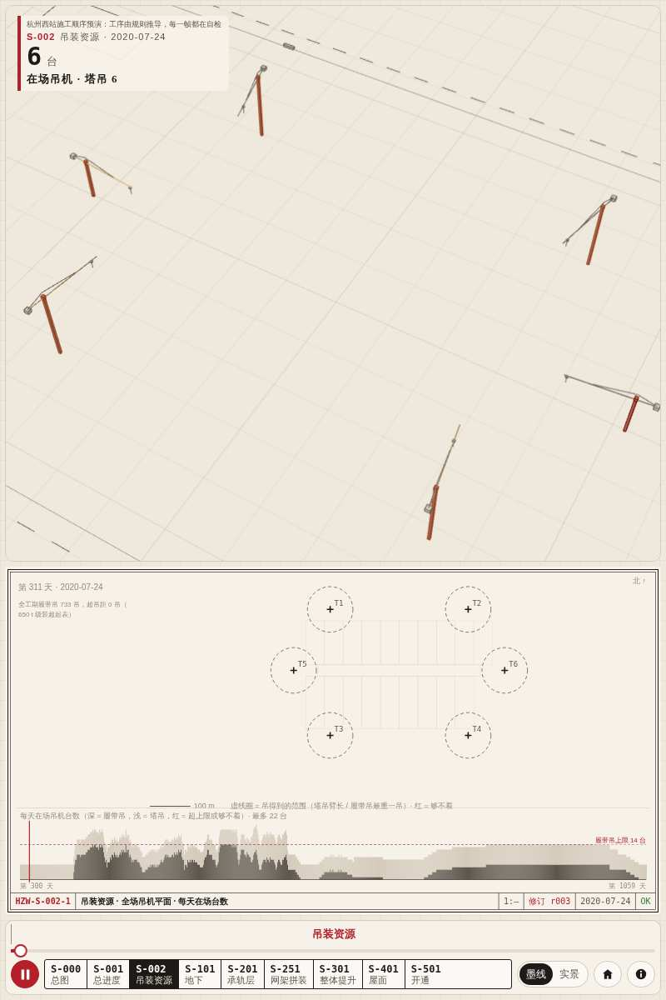

# D-52 · S-002 小画幅 arc 负半径（hark-darrio）

- 修复（1081332）：`web/sheets/s002.js` 算出缩放系数 k 后，若 `k ≤ 0` 或平面区宽/高 < 8 px，直接返回、不画平面；塔吊回转圈与履带吊 R 圈半径另加 `Math.max(0, …)`。
- 检查：`tools/hz/check_s002.js` 新增小画幅用例（80×60、30×200、200×81、31×400、120×90 × 三个时刻），用代理把 `arc` 负半径当报错。旧代码 FAIL（r = −2.6），新代码 OK；`check_all` 24/24。
- 截图：800×1200，深链 `#sheet=S-002`，第 311 天，无控制台报错、首屏非空。

注：宿主 `hzwest.html` 仍引 `s002.js?v=3`，请 hark-cr 合并时一并改版本号（已有请求 77248abe）。
