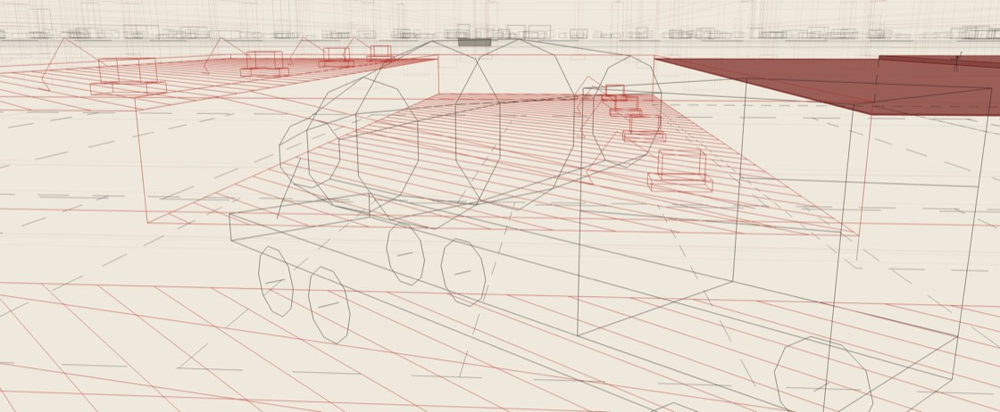
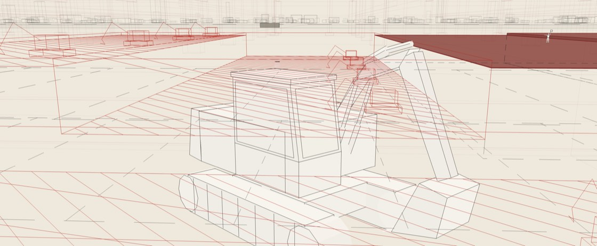
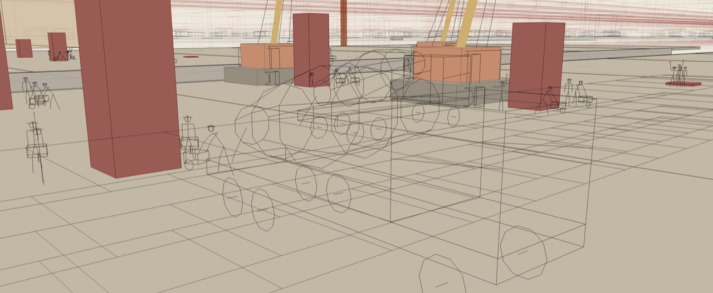
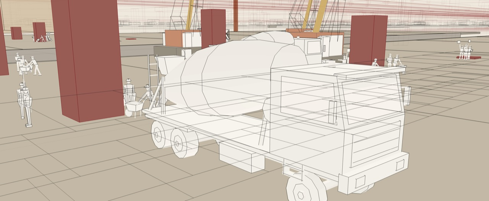
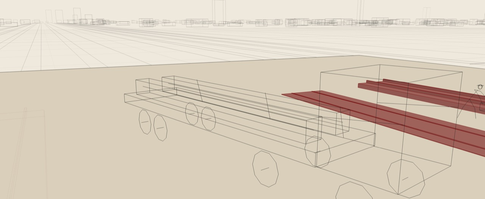
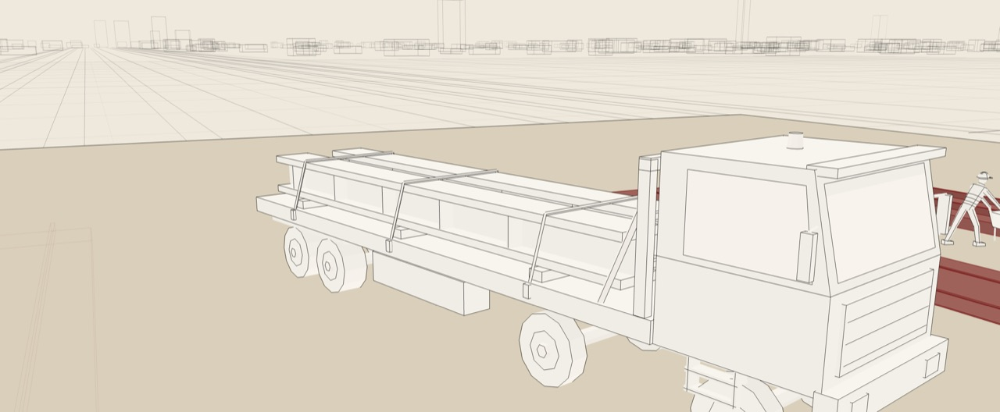
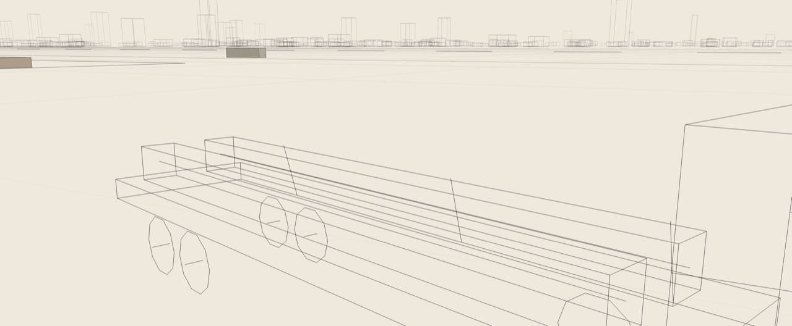
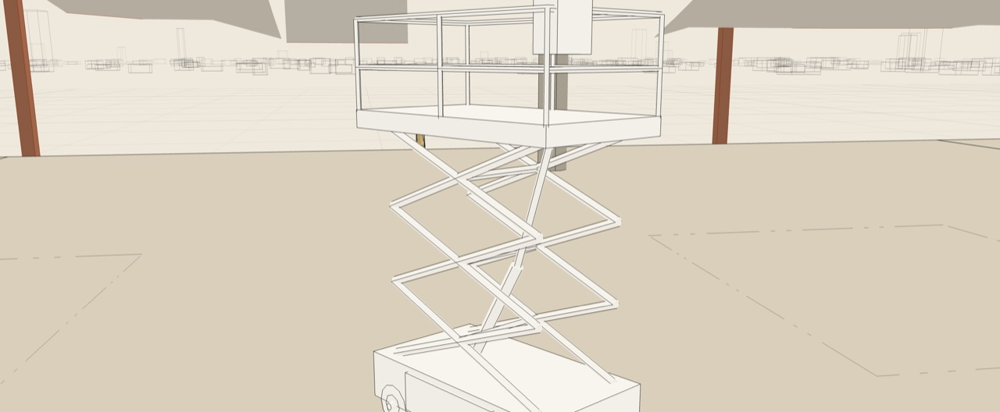

# 近景人员与车辆精修（`web/mods/actors.js`）对照证据

- **作者 / Agent**：`g-fangyi`
- **日期**：2026-11-21
- **分支**：`agent/g-fangyi/actors-detail`
- **对照基线**：`origin/main`（`420444e`，旧版 `actors.js` 纯线框） vs 本分支（纯纸白 `COL.paper` 遮挡体量 + 结构墨线 + `THREE.InstancedMesh`）
- **验看入口**：`web/hzwest.html#sheet=S-000`（墨线模式，镜头拉近至 `< 34 m` 触发精细 LOD）

## 1. 审查意见落实清单

1. **墨线画风统一（阻断项）**：移除所有彩色实体，实体层统一改为纯纸白（`COL.paper = [0.94, 0.91, 0.85]`）遮挡体；所有人物（头盔、帽檐、躯干、腰带、反光带、四肢包络、工装靴、工具）与 4 种工程车辆（轮胎、轮毂、车桥、重卡驾驶室、搅拌筒、龙门架、工字钢货载、绑带、挖掘机履带/配重/全景窗框/鹅颈动臂/双液压油缸/铲斗、剪叉臂/护栏）轮廓全部由墨线绘制，消除背面线框穿透。
2. **对照截图证据**：下表 4 个关键施工时刻均在同一机位下分别截取 `origin/main` 与本分支实机 WebGL 画面，单张均 `≤ 150 KB`。
3. **检查覆盖 `InstancedMesh` 路径**：`tools/hz/check_actors.js` 新增含 `InstancedMesh` + `MeshBasicMaterial` 的桩环境，断言：① 实例总数等于显示的人和车数（`shown`）；② 每种人 `≤ 256`、每种车 `≤ 32`；③ 写入的 4×4 列主序矩阵旋转与位移和 `emit` 的 `yaw` 严格一致；④ `opts.clip` 同步传给线材质与实体材质。
4. **缓存版本号与流程**：已在 `data/claims/requests.jsonl`（`req:2026-11-21:ac70a002`）请集成人将 `web/hzwest.html` 的 `mods/actors.js?v=1` 升为 `?v=2`，并在 `data/claims/claims.jsonl` 补登认领项「近景人员与车辆精修」，提交标题统一改为 `[mods]`。

## 2. 四个关键时刻对照截图（`#sheet=S-000`，近景 `< 34 m`）

| 时刻 `t` | 对应工种 / 机型 | `origin/main`（旧版纯线框） | 本分支（纸白遮挡 + 结构墨线） |
|---|---|---|---|
| `t=120.45` | 地下基坑 `civil` · 履带挖掘机（旧版复用罐车） |  |  |
| `t=385.45` | 主体框架 `frame` · 混凝土搅拌车 + 施工班组 |  |  |
| `t=620.45` | 承轨/钢构 `steel` · 钢构平板拖车 + 推车工人 |  |  |
| `t=720.45` | 网架/屋面 `asm/skin` · 剪叉升降车（旧版复用平板车） |  |  |

## 3. 性能与约束自检

- **实机浏览器近景（`t=385.45`，121 个活跃实例、13,199 条墨线段）**：100 帧近景移动镜头 `update` 均值 `< 0.1 ms/帧`（远低于 `2 ms` 红线）；9 个静态原型几何（4 人物姿态 + 5 车辆/履带吊底盘）仅在 `build` 时上传 GPU 一次。
- **远端全量检查**：推送至收件仓库后由 pre-receive 钩子运行 `node tools/hz/check_all.js` 验收（含新版 `check_actors` 的 `InstancedMesh` 断言与 `check_claims` 校验）。
