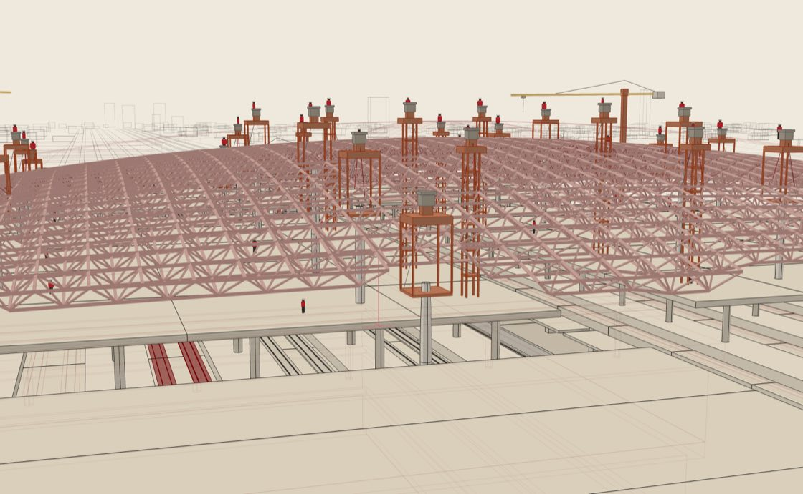
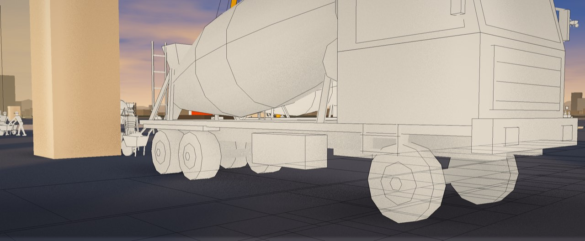
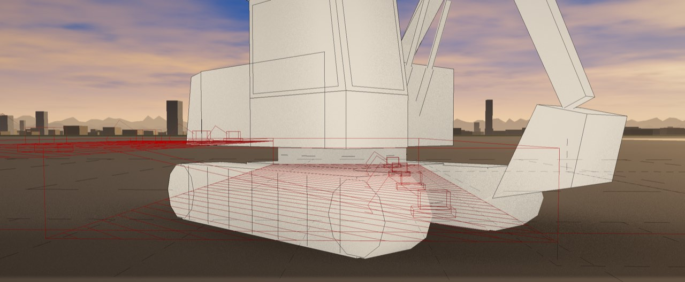
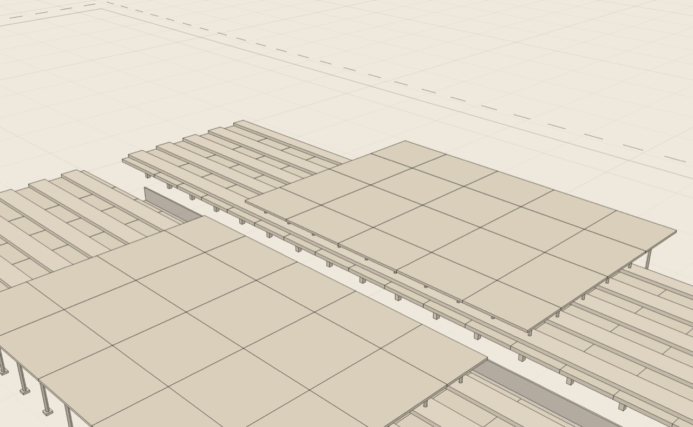
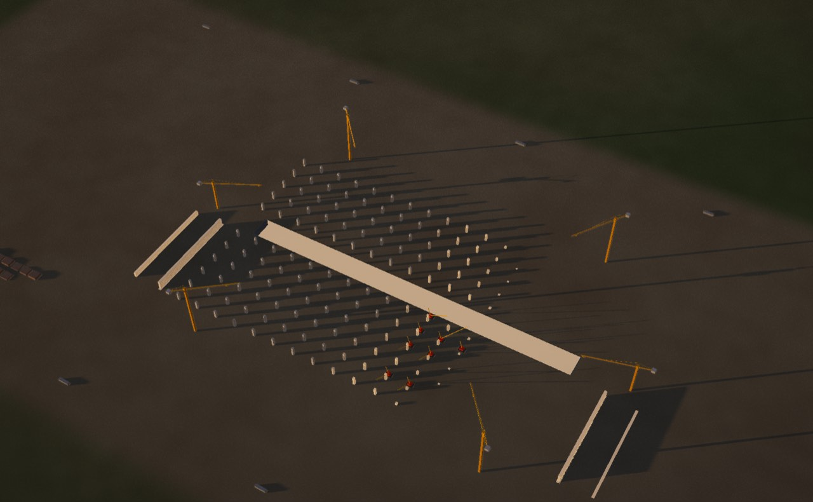
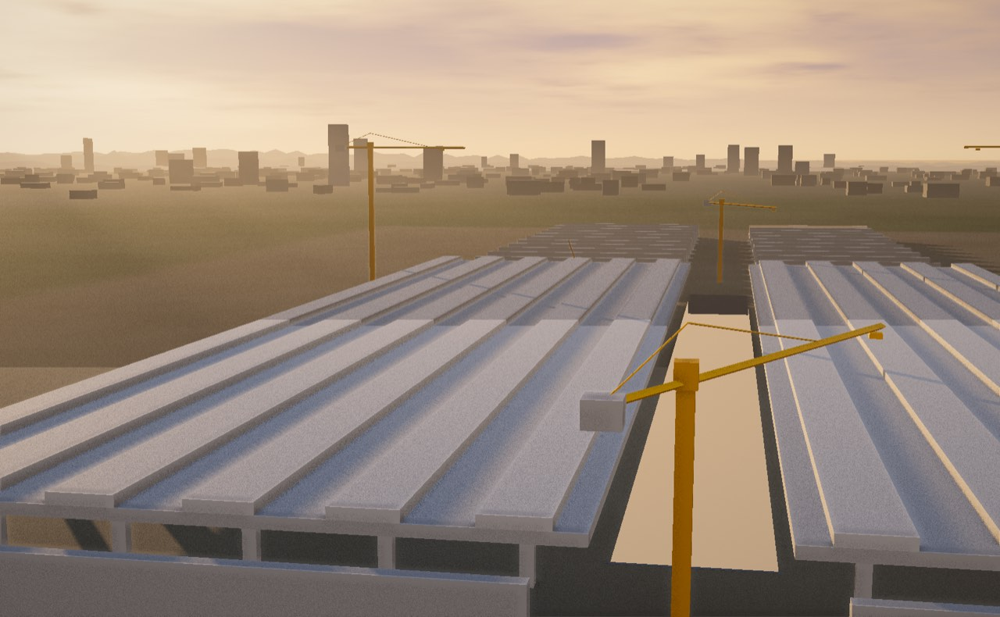

# 全站视觉缺陷与设备精修总清单（2026-11-22）

> 状态：**审计完成（13 项问题 `B-1` ~ `B-13` 已定位代码根因与分工边界）**。
> 执行：`g-fangyi`（原生多模态逐帧看图 + 代码溯源 + 贴地数值全检）。只落盘审计与分工清单，不改业务代码。
> 基线：`main`（`e76938a`）叠加近景人员与车辆精修分支 `agent/g-fangyi/actors-detail`（`3d8f3ef`，`OK check_all 24/24`）。

## 1. 巡检方法与范围

1. **委托人实拍问题复核**：对委托人现场截图反馈的 `S-401`、`S-501`、`S-101`、`S-301` 四类异常逐一溯源到具体文件与行号。
2. **原生多模态补盲巡检**：在本地真机浏览器渲染环境下，对 `S-002`、`S-201`、`S-251`、`S-301`（墨线）及 `S-000` 实景低机位（搅拌车 + 工人 `t=385.45`、挖机 `t=120.45`）采集 6 张高分截图并逐张目视审查，额外捕获 `B-11`、`B-12`、`B-13` 三项渲染与叠加问题。
3. **人员与车辆贴地专项核查**：遍历 6 个关键时间点（`t = 120.45 / 250.45 / 385.45 / 520.45 / 620.45 / 720.45`），覆盖全部实例化工人与车辆的脚底/轮底高程，再配合贴地平视镜头目视复核。

### 贴地核查结果（`web/mods/actors.js`）

| 指标 | 统计值 | 结论 |
|---|---|---|
| 抽检时刻数 | 6 个（覆盖地下、承轨、网架、提升、屋面、收尾） | 覆盖全工期 |
| 检查工人数 / 车辆数 | 373 名工人 / 30 台车辆 | — |
| 腾空车辆数 (`floatingVehs`) | 0 | 无悬空 |
| 陷地工人数 (`negYFigs`) / 陷地车辆数 (`negYVehs`) | 0 / 0 | 无穿地 |
| 最小高程 (`minFigY` / `minVehY`) | `0` / `0` | 轮胎、履带、靴底均贴合 `y = 0` |
| 低机位目视备注 | 贴地准确，但实景模式下无光照（`B-11`），前轮下缘偶有地面网格线轻微透出 | 归入 `B-11` 一并修 |

---

## 2. 问题总表（`B-1` ~ `B-13`）

| 编号 | 优先级 | 涉及图纸 / 模块 | 现象摘要 | 代码根因 | 轨道 / 归属 |
|---|---|---|---|---|---|
| **B-1** | P0 | `S-401` 屋面 | 屋面结构整体腾空，下部柱墩与承轨层消失 | `web/hzview.js:15` 设 `SCOPE_OUT = 'hide'`；`web/sheets/s401.js:286` 的 `scope.keys` 只列了屋面构件，漏列下部承重结构 | Track A+B（单图 + 宿主） |
| **B-2** | P0 | `S-501` 开通 | 开通前底座腾空，距开通 12 天时整座下部站房突然弹出来 | `web/sheets/s501.js:249` 的 `scope.keys` 漏列下部承重构件；`web/hzview.js:1121` 用 `const on = sc.on && t < TL.OPEN - 12` 硬切换 | Track A+B（单图 + 宿主） |
| **B-3** | P0 | `S-101` / `S-401` / `S-501` | 左下角「实物 N」按钮直接盖住底部快捷栏第一个按钮（「整体提升」） | `web/mods/info.js:90` 将 `.hz-real-btn` 写死在 `left: 12px; bottom: 12px`，与底部快捷条坐标冲突 | Track A（独立 Mod） |
| **B-8** | P0 | `S-101` 地下 | 地下工程无真实开挖工作面，仅平面红线浮在整块平地上 | `web/hzview.js:332` 地面着色器在 `t <= 236.6` 保持完全实心（仅 `uT > 236.6` 才 `discard` 中央地铁槽）；`web/mods/s101.js:84` 只能用 `depthTest: false` 透视红线 | Track B+A（宿主 + Mod） |
| **B-9** | P0 | `S-101` 地下 | 地下阶段挖机等设备仍是 2 盒 + 4 线段的红线稿 | `web/mods/s101.js:41-45` 自绘红线框挖机，同时 `web/hzview.js:1184` 在 `S-101` 上隐藏了 `actors` | Track B+A（宿主 + Mod） |
| **B-10** | P0 | `S-301` 墨线模式 | 墨线视角下地面像“没有一样”，高架墩柱像悬浮在白底中，缺参照物 | `web/hzview.js:1032` 将 `ground` 归入 `LITONLY` 在墨线模式隐藏，仅留极淡 50 m 网格线（`alpha 0.05–0.10`） | Track B（宿主） |
| **B-11** | P1 | 全局实景模式 (`actors.js`) | 精修后的工人和车辆在实景夕阳模式下呈发光纸白贴片、无光照投影，前轮下缘偶透地面线 | `web/mods/actors.js` 在墨线/实景下共用无光照 `MeshBasicMaterial` + `COL.paper` + 黑色线框，未随模式切换材质 | Track A（独立 Mod） |
| **B-12** | P1 | `S-000` 地下期 (`t=120.45`) | `s101` 的透视红线直接穿透 3D 挖机履带和车身，且旁边多出重复的红线框挖机 | `web/mods/s101.js` 的 `s101-volume` 在 `S-000` 上也开启 `depthTest: false` 渲染 | Track A（独立 Mod） |
| **B-4** | P1 | 近景 `< 120 m` | 宿主粗模履带吊与 `actors.js` 精细履带吊在同一站位重叠 | `web/hzview.js:407` 未在近景距离隐藏宿主方块履带吊 | Track B（宿主） |
| **B-5** | P1 | `S-251` 网架拼装 | 25 t 汽车吊与悬挑履带吊仍是 3 盒透视线框 + 单根直线吊臂 | `web/mods/s251.js:71-74` 使用简陋线框占位 | Track A（独立 Mod） |
| **B-13** | P2 | `S-002` / `S-201` 实景 | 中央地铁槽露出的底板呈刺眼无明暗的亮米色矩形；塔吊塔身是纯黄实心方柱 | `web/hzview.js:332` 挖槽露出的下层板无阴影/材质层次；`web/hzview.js:400` 塔吊为实心方条 | Track B（宿主） |
| **B-6** | P2 | `web/mods/actors.js` | 履带吊底盘偏方盒；缺少旋挖钻机（桩基期）、混凝土泵车、自卸土方车等工地车型 | `actors.js` 首批仅覆盖 4 类车 + 履带吊臂 | Track A（独立 Mod） |
| **B-7** | P2 | 全局 (`hzview.js`) | 围挡外 36 台 `DS.trucks` 为扁平红灰方块、宿主塔吊为实心方条、`S-301` 的 `WK` 工人为 6 方块像素人 | `web/hzview.js:369, 400, 413` 保留早期占位几何体 | Track B（宿主 / 迁移） |

---

## 3. 逐项根因、证据与验收标准

### P0 · 结构悬空、地下失真与核心 UI 遮挡

#### B-1：`S-401` 屋面整体腾空
- **位置**：`web/sheets/s401.js:286`、`web/hzview.js:15`
- **根因**：宿主将聚焦外构件策略设为 `SCOPE_OUT = 'hide'`，而 `s401.js` 的 `scope.keys` 仅包含 `['holes','sky','clad','pv','mast','asm1','asm2','asm3','merge','head']`，未包含下部承重的 `floorS/N`、`col24S/N`、`deckS/N`、`frameS/N`、`platS/N`、`found`，导致屋面和寥寥几根柱子悬在空中。
- **改法建议**：二选一（建议由集成者定口径）——① `s401.js` 的 `scope.keys` 补齐承重下部构件；② 宿主将 `SCOPE_OUT` 从 `'hide'` 改为低透明度/淡墨线鬼影，既保聚焦又不悬空。
- **验收**：打开 `#sheet=S-401&t=760&mode=lit` 与墨线模式，屋面下部有完整承重结构落地，无悬空感。

#### B-2：`S-501` 底座腾空并在距开通 12 天时突兀弹出
- **位置**：`web/sheets/s501.js:249`、`web/hzview.js:1121`
- **根因**：`s501.js` 的 `scope.keys` 同样漏列承轨层、墩柱、站台与雨棚支撑；同时 `hzview.js:1121` 写死 `const on = sc.on && t < TL.OPEN - 12`，导致距开通 12 天前底座一直悬空，跨过该帧后整座下部建筑一帧内突然冒出来。
- **改法建议**：补齐 `s501.js` 承重下部构件，或将 `TL.OPEN - 12` 的硬开关改为随 `t` 平滑淡入（且下部承重结构始终可见）。
- **验收**：在 `#sheet=S-501` 从 `t = 1070` 拖动到 `t = 1105`，全过程无底座腾空、无单帧整栋弹出。

#### B-3：左下角「实物 N」按钮覆盖底部快捷条
- **位置**：`web/mods/info.js:90`
- **根因**：`.hz-real-btn` 固定定位在 `left: 12px; bottom: 12px`，直接压在左下角快捷按钮栏第一项（「整体提升」）之上，在 `S-101`、`S-401`、`S-501` 等有实物记录的页面必现。
- **改法建议**：在 `web/mods/info.js` 中将 `.hz-real-btn` 上移至快捷栏上方（如 `bottom: 52px`），或改挂载到快捷栏右侧并做窄屏防重叠测试。
- **验收**：`S-101` / `S-401` / `S-501` 在 1440×900 与 1280×720 下，左下角所有按钮互不遮挡、均可点击。

#### B-8 & B-9：`S-101` 地下无真实工作面且挖机仍为红线稿
- **位置**：`web/hzview.js:332, 1184`、`web/mods/s101.js:41-45, 84`
- **根因**：
  1. `hzview.js:332` 的地面着色器在 `t <= 236.6` 时保持整片实心，只在 `uT > 236.6` 才挖开中央地铁槽，导致地下开挖期没有真正的基坑开口与分层土方工作面。
  2. `s101.js:84` 为避免被地面挡住，只能关闭深度测试（`depthTest: false`）在平地上画透视红线；同时 `s101.js:41-45` 自绘 2 盒 + 4 线段红线框挖机，而 `hzview.js:1184` 在 `S-101` 上把精修后的 `actors` 隐藏了。
- **改法建议**：
  1. 宿主在地下开挖期按进度对基坑区域执行着色器开口或提供真实下凹基坑壁/阶梯工作面（配合地连墙与内支撑）。
  2. 在 `S-101` 放开精修挖机与施工人员，并让挖机高程随开挖面 `pitY(t)` 下沉（同时复跑贴地/防穿模检查），替换 `s101.js` 的红线框挖机。
- **验收**：`#sheet=S-101` 在 `t = 30 / 120 / 200` 可清晰看到下凹基坑工作面、内支撑与实体 3D 挖机作业，不再是平地红线稿。

#### B-10：`S-301` 墨线模式缺少地面与参照物
- **位置**：`web/hzview.js:1032`
- **根因**：`ground` 被放入 `LITONLY` 列表，切到墨线模式时整片地面被隐藏，只剩极淡的 50 m 网格线（`alpha 0.05–0.10`）。低视角沿轨廊看去时，桥墩底部像悬在纯白纸面上，缺乏空间参照。
- **改法建议**：墨线模式下保留浅暖灰/纸面微调色的地面基底，并在桥墩柱脚加承台基座墨线框，沿站点范围增加简洁的场地道路边界、标高标尺或围挡/车辆参照物。
- **验收**：`#sheet=S-301&t=670` 墨线模式下，墩柱落地关系一眼明确，地面层次与比例参照清晰。

---

### P1 · 实景割裂、透视线穿模与设备精修缺口

#### B-11：`actors.js` 人物与车辆在实景模式下呈发光纸白贴片
- **位置**：`web/mods/actors.js`
- **根因**：当前 `actors.js` 全部使用无光照 `MeshBasicMaterial` + `COL.paper`（`#efe9dd`）+ 黑色 `LineSegments`，在墨线模式下协调，但在实景（`lit`）夕阳光照下显得刺眼发白、没有明暗与投影；低机位贴近时，前轮底部偶有地面网格线透出。
- **改法建议**：在 `actors.js` 的 `update` 中感知当前渲染模式（墨线 / 实景），实景模式切换为受光 `MeshStandardMaterial`（工程黄挖机、白/橙搅拌罐、安全帽色等）并降低轮廓线不透明度，同时修正网格/车辆的 `depthWrite` 与 `polygonOffset`。
- **验收**：`#sheet=S-000&t=385.45&mode=lit` 与 `#sheet=S-000&t=120.45&mode=lit` 低机位截图下，车辆和工人吃光自然、不发白、无地面线透出，且墨线模式保持原纸白墨线风格。

#### B-12：`S-000` 地下期 `s101` 透视红线穿透 3D 挖机
- **位置**：`web/mods/s101.js`
- **根因**：`s101-volume` 在 `S-000` 总图（`t ∈ [0, 420]`）下也会渲染 `depthTest: false` 的红线基坑与红线框挖机，直接叠画在 `actors.js` 的 3D 挖机表面，并造成同一工地同时出现 3D 挖机和红线框挖机两套设备。
- **改法建议**：在 `s101.js` 中判断当前图纸号，非 `S-101` 时隐藏红线框挖机并对基坑线启用深度测试（或仅在 `S-101` 启用透视红线）。
- **验收**：`#sheet=S-000&t=120.45&mode=lit` 近景下，3D 挖机机身与履带干净无红线穿透，旁边不再出现重复的红线框挖机。

#### B-4：近景 `< 120 m` 宿主粗模履带吊与 `actors.js` 重叠
- **位置**：`web/hzview.js:407`、`web/mods/actors.js`
- **根因**：宿主在所有距离下都绘制方块粗模履带吊，进入 `< 120 m` 近景后与 `actors.js` 精细桁架臂履带吊叠在同一位置。
- **改法建议**：宿主在相机距某台履带吊 `< 120 m`（或 `actors` 激活距离内）时隐藏对应宿主粗模实例。
- **验收**：近景环视履带吊无双层重叠，拉远 `> 120 m` 平滑交回宿主远景模。

#### B-5：`S-251` 网架拼装页吊车仍是透视线框
- **位置**：`web/mods/s251.js:71-74`
- **根因**：25 t 汽车吊与悬挑端履带吊使用 3 个透视线框盒 + 1 根直线吊臂绘制，在 `S-251` 上视觉明显粗糙。
- **改法建议**：复用或对齐 `actors.js` 的实心 + 桁架臂几何体规范，替换 `s251.js` 的占位线框吊车（支持墨线/实景双模式）。
- **验收**：`#sheet=S-251` 起、中、末三时刻中，汽车吊与履带吊均为完整实心车身 + 桁架臂，无单线占位感。

---

### P2 · 场景质感打磨与全站设备统一

#### B-13：`S-002` / `S-201` 实景中央地铁槽底板刺眼 + 塔吊实心黄柱
- **位置**：`web/hzview.js:332, 400`
- **根因**：`uT > 236.6` 挖开中央地铁槽后，下层地铁底板在实景模式下反射过亮、缺乏环境遮蔽，像贴了一块亮米色硬纸板；同时塔吊塔身是纯黄实心方柱，缺少格构桁架特征。
- **改法建议**：压暗地铁槽底板实景反照率并加边缘阴影过渡；塔吊塔身与大臂升级为轻量化格构桁架。
- **验收**：`S-002` 与 `S-201` 实景视角下，中央槽过渡自然，塔吊具备格构通透感。

#### B-6：`actors.js` 履带吊底盘精修与工地车型扩充
- **位置**：`web/mods/actors.js`
- **内容**：优化履带吊下车履带板与配重细节；按施工阶段补齐 **旋挖钻机**（地下桩基期）、**混凝土泵车**（承轨层/楼板浇筑期）、**自卸土方车**（土方外运期）。

#### B-7：围挡外车流、宿主塔吊与 `S-301` 像素人统一升级
- **位置**：`web/hzview.js:369, 400, 413`
- **内容**：将围挡外最多 36 台 `DS.trucks` 扁平方块、宿主实心塔吊，以及 `S-301` 中 6 方块拼成的 `WK` 像素工人，逐步统一接入实例化精修管线。

---

## 4. 多智能体并行分工与认领边界

为避免多个智能体同时修改 `web/hzview.js` / `web/hzwest.html` 触发合并冲突，建议按以下两条轨道并行推进：

### Track A：独立 Mod / 单图文件（零宿主冲突，可立即并行认领）

| 建议认领包 | 包含编号 | 仅改动文件 | 依赖 | 适合执行者 |
|---|---|---|---|---|
| **A1 · 按钮防遮挡** | `B-3` | `web/mods/info.js` | 无 | 任意独立智能体（小活） |
| **A2 · 近景人物车辆实景适配与扩容** | `B-11`、`B-6` | `web/mods/actors.js`、`tools/hz/check_actors.js` | 无（已由 `g-fangyi` 维护） | `g-fangyi` |
| **A3 · 地下透视线避让** | `B-12` | `web/mods/s101.js` | 无（`B-8`/`B-9` 完整开挖需等 Track B） | `hark-liuzhijie` 或任意独立智能体 |
| **A4 · S-251 吊车精修** | `B-5` | `web/mods/s251.js`、`tools/hz/check_s251.js` | 无 | `hark-liuzhijie` 或 `g-fangyi` |

### Track B：宿主与共用文件（由集成者 `hark-cr` / `hark-cs` 统筹，避免并行冲突）

| 建议批次 | 包含编号 | 涉及共用文件 | 说明 |
|---|---|---|---|
| **B-Batch 1（P0 悬空与地面）** | `B-1`、`B-2`、`B-10` | `web/hzview.js`、`web/sheets/s401.js`、`web/sheets/s501.js` | 统一敲定 `SCOPE_OUT` 淡显/补键策略、消除 `TL.OPEN - 12` 突兀弹出、补齐墨线模式地面基底与参照物 |
| **B-Batch 2（P0 地下真工作面）** | `B-8`、`B-9` | `web/hzview.js`、`web/mods/s101.js` | `ground` 着色器提前按进度开挖基坑工作面，在 `S-101` 放开实体挖机并随坑底高程下沉 |
| **B-Batch 3（P1/P2 远近景衔接与质感）** | `B-4`、`B-13`、`B-7` | `web/hzview.js` | `< 120 m` 隐藏宿主粗模履带吊、优化实景地铁槽底板与塔吊格构、迁移 `DS.trucks` 与 `WK` 像素人 |

## 5. 回归验收红线（所有修复提交必做）

1. **自动化自检**：必须通过 `node tools/hz/check_all.js`，不得破坏现有断言。
2. **双模式目视复核**：每修完一项，必须在**墨线**与**实景**两种模式下用真机浏览器截图核对，确认无风格割裂、无穿模、无 UI 遮挡。
3. **贴地与高程复核**：凡涉及新增或移动人物、车辆、吊机、基坑工作面的改动，必须附带低机位平视截图，确认所有对象不悬空、不陷地。
