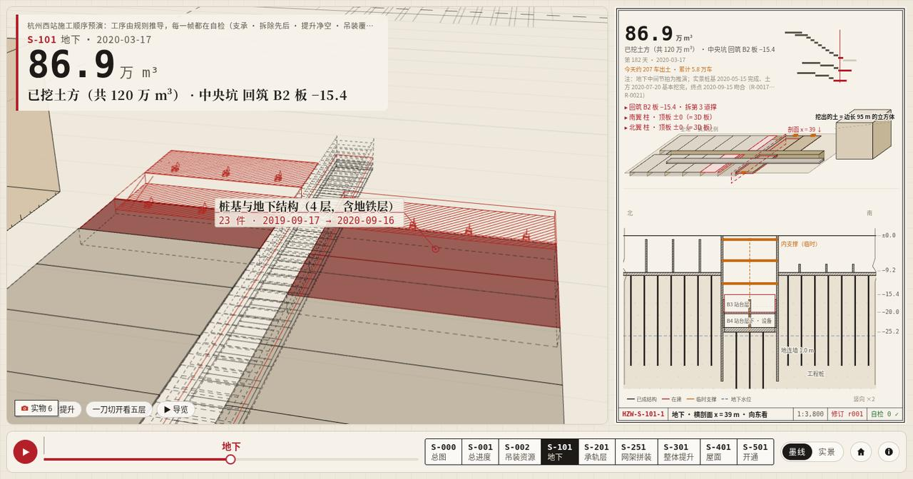
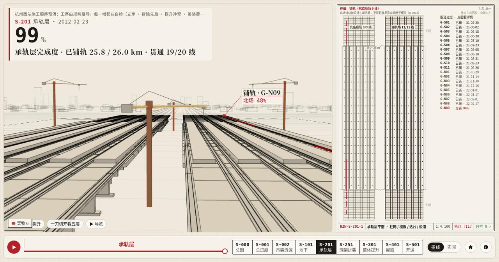
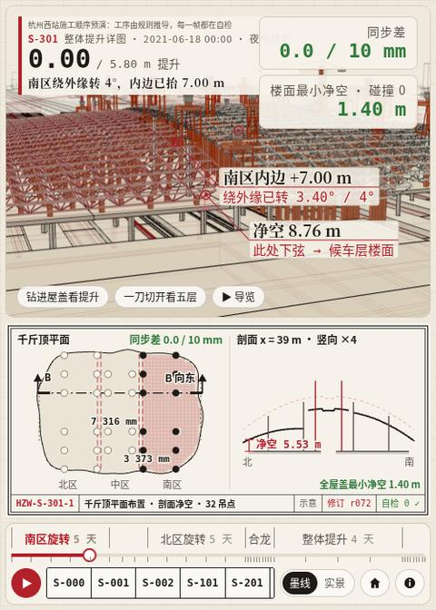
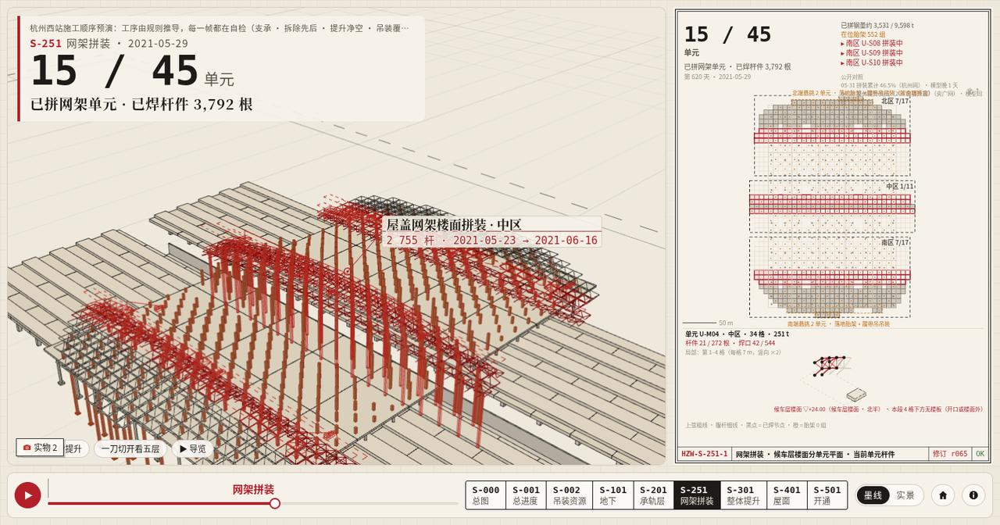
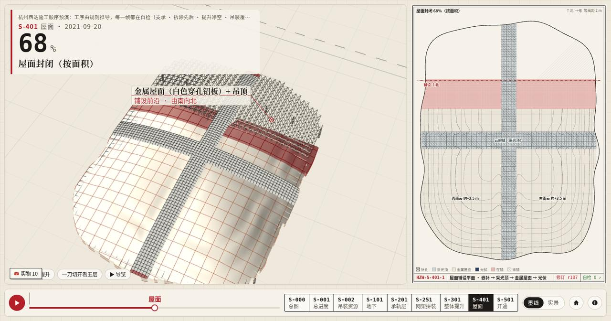
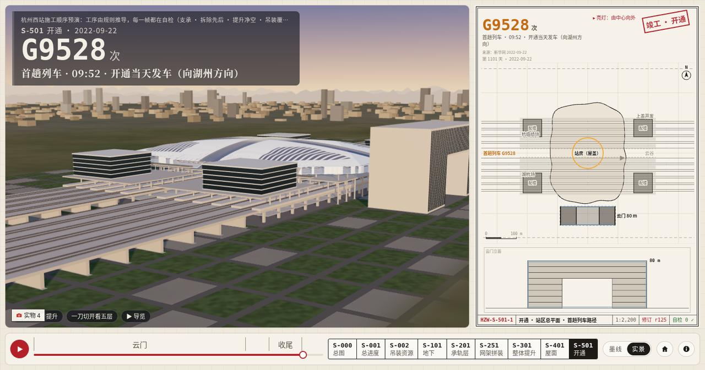

# 线上图册全量视觉审查报告（2026-11-22，g-wangmushan）

## 1. 审查环境与范围
- **目标版本**：线上 `https://changrong996-droid.github.io/hzwest-atlas/web/hzwest.html?noIntro`（对应 `main` `e85881b`，含最新合入的 `tour.js` 与 `actors.js?v=2`）。
- **工具与限制**：Linux 云沙盒无头 Chromium 156 + Selenium + SwiftShader 软渲染 WebGL；本报告只审查视觉、布局、数据一致与控制台报错，**不报 fps**（真实帧率由本地 GPU 节点复测）。
- **覆盖画面（19 帧）**：
  - 桌面 `1440×900`（15 帧）：`S-000`（t=661 / t=1101 实景 / t=582 云谷穿行）、`S-001`（650）、`S-002`（650）、`S-101`（182）、`S-201`（632 / 890）、`S-251`（620）、`S-301`（640 J23 提升 / 661 剖切）、`S-401`（734 / 785）、`S-501`（1080 / 1101 实景）。
  - 手机竖屏 `390×844`（4 帧）：`S-000`（661）、`S-201`（632）、`S-301`（640）、`S-501`（1101 实景）。
- **基础健康度**：JS / WebGL 严重报错（`SEVERE`）**0 条**；全部图纸 **0 空白**；仅 12 条 Three.js `BufferAttribute.updateRange()` 弃用提示（`WARNING`）；`tour.js` 云谷穿行帧 0 穿模。

---

## 2. 问题总表（按优先级）

| 编号 | 级别 | 图号 / 视口 | 时刻 `t` | 现象摘要 | 归属文件（建议） | 状态 |
|---|---|---|---|---|---|---|
| V-01 | **P0** | 全局带实物分图（桌面 & 手机） | 任意 | 左下角 `📷 实物 N` 死压在 `钻进屋盖看提升` 传送门上 | `web/mods/tour.js` | 已另开分支 `agent/g-wangmushan/tour-portals-pos` 修复 |
| V-02 | **P0** | `S-201`（桌面） | `890` / `632` | 3D 引线 `G-N09` 报 `48%`，右图进度表同一行报 `70%`（差 22%） | `web/sheets/s201.js` | 待派单 |
| V-03 | **P0** | `S-301`（手机 `390×844`） | `640` | 左上 `#big` 与右上 `#rd`（同步差）重叠，遮挡日期与「夜间锁定」 | `web/hzmobile.css` | 待派单 |
| V-04 | **P1** | `S-251`（桌面） | `620` | 右侧图纸北区上方「北端悬挑」橙字与「公开对照」灰字完全重影 | `web/sheets/s251.js` | 待派单 |
| V-05 | **P1** | `S-101`（桌面） | `182` | 右侧图纸轴测图上方 `▶ 北翼 柱·顶板` 红字与 `全长同比例` 灰字重叠 | `web/sheets/s101.js` | 待派单 |
| V-06 | **P1** | `S-401`（桌面） | `734` | 3D 屋面西南角与十字采光顶南端被画布底边轻微裁切 | `web/sheets/s401.js` | 待派单 |
| V-07 | **P2** | 手机 `390×844`（`S-301 / S-501`） | 任意 | 切到靠后图号时，底部页签条未自动滚动使当前激活页签可见 | `web/hzview.js`（或 `hzmobile.css`） | 待派单 |
| V-08 | **P2** | `S-501` 实景 & 全局带右栏分图 | `1101` / 任意 | 云门西侧立面素白无分格且右缘裁切；`📷 实物 4` 实景下仍亮白；桌面带右栏分图 `#lede` 截成 `吊装覆…` | `web/mods/yunmen.js`、`web/mods/info.js`、`web/hzwest.html` | 待派单 |

---

## 3. 逐项实拍证据与建议修法

### V-01（P0）· 左下角 `📷 实物 N` 与 `tour.js` 传送门栏重叠
- **复现**：`#sheet=S-101`（`t=182`）、`S-201`、`S-251`、`S-401`、`S-501`，桌面 `1440×900` 与手机 `390×844` 均复现。
- **现象**：`web/mods/info.js` 的 `📷 实物 N` 与 `web/mods/tour.js` 的 `#hz-tour-portals` 同时定位在左下角 `left: 12px; bottom: 10px`，导致「钻进屋盖看提升」只露出「提升」两字。
- **修法**：将 `#hz-tour-portals` 移至 3D 视口右下角（`right: 12px; left: auto; bottom: 10px`），与左下角实物按钮彻底错开（由本人在 `agent/g-wangmushan/tour-portals-pos` 同步提交修复）。
- **证据**（同图亦含 V-05 右图撞字）：

### V-02（P0）· `S-201` 承轨层 3D 引线与右侧图纸进度相差 22%
- **复现**：`#sheet=S-201`，`t = 890`（2022-02-23），桌面 `1440×900`（另 `t = 632` 时 `G-S05` 亦存在 `2%` vs `1%` 差异）。
- **现象**：3D 引线显示 `铺轨 · G-N09 / 北场 48%`，但右侧图纸股道进度表同一行 `G-N09` 显示 `在铺 70%`。
- **修法**：统一 `web/sheets/s201.js` 中 `leadAt(t)` 与 `draw()` 的股道进度计算函数，消除第二真相源。
- **证据**：

### V-03（P0）· 手机竖屏 `S-301` 左上 `#big` 与右上 `#rd` 重叠
- **复现**：`390×844` 竖屏，`#sheet=S-301`，`t = 640`（DOM 探针同步报 `overlaps: ["big<->rd"]`）。
- **现象**：右上「同步差 0.0 / 10 mm」盖住 `#big` 的日期行及「夜间锁定」；同图亦见 V-07（底部页签条未滚动到 `S-301`）。
- **修法**：在 `web/hzmobile.css` 竖屏样式中缩小两卡片宽度或将 `#rd` 移至 `#big` 下方紧凑排列。
- **证据**：

### V-04（P1）· `S-251` 右侧图纸北区上方两行字重影
- **复现**：`#sheet=S-251`，`t = 620`（2021-05-29），桌面 `1440×900`。
- **现象**：橙字 `北端悬挑 2 单元 · 落地胎架+履带吊吊装（对称推定）` 与灰字 `06-28 提升完成（央广网），模型同日` 重叠糊成一团。
- **修法**：在 `web/sheets/s251.js` 中将两行标注纵坐标拉开 ≥ 14 px。
- **证据**：

### V-05（P1）· `S-101` 右侧图纸轴测图上方撞字
- **复现**：`#sheet=S-101`，`t = 182`（2020-03-17），桌面 `1440×900`（见 V-01 同一实拍图右侧中上部）。
- **现象**：红字 `▶ 北翼 柱·顶板 ±0 (= 3D 板)` 与下方灰字 `全长同比例` 重叠。
- **修法**：在 `web/sheets/s101.js` 中将轴测图块下移 ~12 px，或将 `全长同比例` 移至轴测图左下角。

### V-06（P1）· `S-401` 屋面 3D 视口左下角轻微裁切
- **复现**：`#sheet=S-401`，`t = 734`（2021-09-20），桌面 `1440×900`。
- **现象**：屋面西南角及十字采光顶南端被画布底边切掉一小块。
- **修法**：在 `web/sheets/s401.js` 中段 `cam` 关键帧略微拉远 `dist` 约 8–10%。
- **证据**：

### V-07 / V-08（P2）· 手机页签未自动居中、`S-501` 实景云门与 `#lede` 截断
- **复现**：`390×844` 切至 `S-301 / S-501`（见 V-03 图底部）；桌面 `1440×900` `#sheet=S-501` `t = 1101` 实景。
- **现象**：手机端激活靠后图号时底部页签未 `scrollIntoView`；`S-501` 实景右侧云门侧面呈素白平板且被右缘裁切，`📷 实物 4` 在深色实景下仍是白底；桌面带右栏的 8 张分图左上 `#lede` 长句被截断成 `吊装覆…`。
- **证据**：

Agent: g-wangmushan
