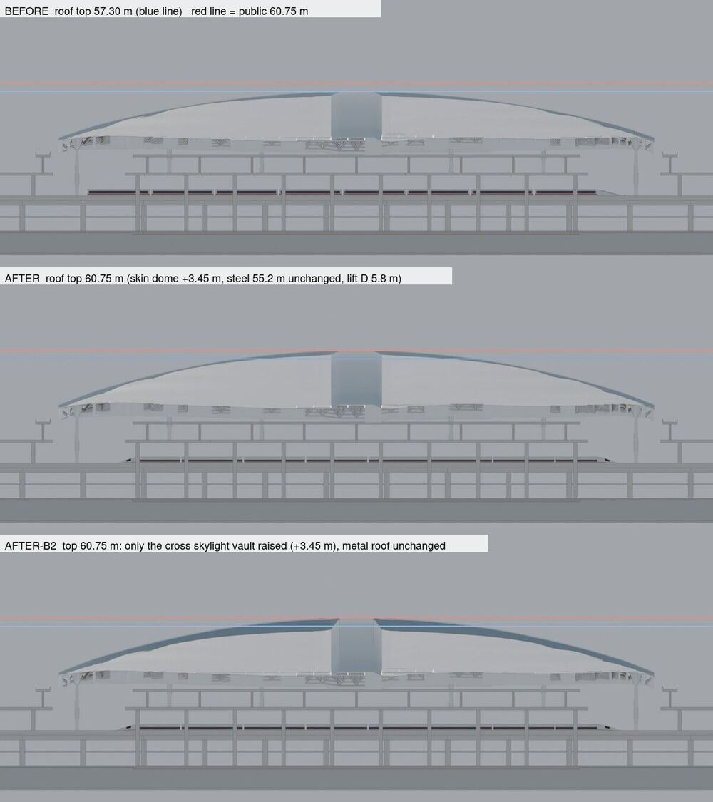
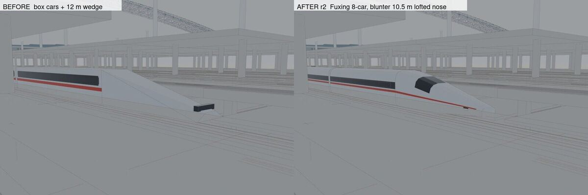

# 定型提案：屋面高度对齐公开数据 + 首趟列车换成复兴号流线车头

hark-cs · 2026-11-08 · 状态：**提案 + 补丁草稿，未改任何共用文件**，等 hark-cr 审后合并。
补丁：`docs/proposals/shape-freeze.patch`（`git apply` 到 origin/main 4490777 可干净应用）。对照图：`docs/proposals/img/shape-freeze-roof.jpg`、`shape-freeze-train.jpg`。

一句话：**屋面——公开数据本身打架（「高 57 米」4 处 vs「最高点 60.75/60.8 米」2 处），现模型 57.3 m 正好对上「57 米」口径；在 A/B 里推荐 B（钢结构不动、只抬覆面，D 仍 5.8 m），但补丁默认 `skinTop: null` 不抬，等委托人定口径后改成 60.75 一行即可启用。列车——换成 8 编组复兴号：209.55 m 长、10.5 m 放样流线车头、银灰车体 + 黑窗带 + 红腰线，直接上。**

---

## 1. 现状（改前）

| 项 | 模型现值 | 在哪 |
|---|---|---|
| 钢结构最高点 Ht(0,0) | 55.2 m（`roofHi`） | `web/hzseq.js:52`、`:75` |
| 金属屋面最高点 max Hc | **57.30 m**（= 55.2 + 0.5 覆面厚 + 1.6 天窗拱） | `web/hzseq.js:89` |
| 整体提升高度 D | 5.8 m（规则推出：拼装姿态最低下弦 ≥ 候车层 + 1.2 m） | `web/hzseq.js:242`，`check_make` 断言 D≈5.8 |
| 首趟列车 | 8 节 25.5 m 方盒 + 0.8 m 缝 + 12 m 楔形车头，全长 221.6 m、宽 3.2 m、白色 | `web/hzview.js:176–181`，`web/sheets/s501.js:24`（TRAIN 常量同步） |

模型坐标：`y = 0` 就是站房地面 ±0.00（`web/hzseq.js:3`「原点 = 站房中心、地面 ±0」；1F ±0、3F 站台 14.5 m、4F 候车 24 m 与公开分层一致）。

## 2. 公开数据与来源

### 屋面高度
| 数据 | 来源（打开核对过） |
|---|---|
| **屋面最高点标高 60.75 m**，屋面由金属屋面、十字天窗、消防透气天窗、马道组成；长边约 334 m、短边约 249 m（这是屋面板外轮廓，比钢结构大一圈） | 中国日报网 2021-08-31（金属屋面闭水当天，承建方中铁建工口径）https://zj.chinadaily.com.cn/a/202108/31/WS612dd9bca3101e7ce976135c.html |
| 建筑最高点标高 60.8 m | 杭州日报 2022-09-16（转载于杭州政协网）https://www.hzzx.gov.cn/cshz/content/2022-09/16/content_8354807.htm |
| **屋盖钢结构最大标高 55.237 m，最小 37.070 m**；平面 325.7 × 245 m | 《施工技术》2022 年 6 期，江苏沪宁钢机（钢结构分包）https://www.fx361.com/page/2022/0428/14548749.shtml |
| 屋盖钢结构 326 × 245 m | 澎湃 2021-09-10（任务书已核） |
| 「站房最高处约 57 米」 | 杭州网 2020-07-21（开工前口径）https://hznews.hangzhou.com.cn/chengshi/content/2020-07/21/content_7777753.htm |
| 「高 57 米」（杭州西站党支部书记介绍，开通当天） | 中新网 2022-09-22 http://www.chinanews.com.cn/sh/2022/09-22/9858490.shtml |
| 「地上 5 层，地下 4 层，高 57 米」 | 杭州网 2022-08-29 https://hznews.hangzhou.com.cn/chengshi/content/2022-08/29/content_8340969_0.htm |
| 「站房最高处约 57 米」（开通当天通稿） | 中国国际工程咨询协会转载 https://www.cncico.com/content/31398 |

**基准怎么看（没能核实，如实写）**：
- 模型 y = 0 = 站房 ±0.00（首层地面），钢结构 55.237 m 来自钢结构分包的论文，按惯例是相对 ±0.00 的标高，模型 55.2 m 已对上。
- 「57 米」有 4 处（2020 开工前、2022-08-29、开通当天两篇），其中开通当天是车站党支部书记的口径；「60.75 / 60.8 米」有 2 处（2021 屋面闭水、2022-09-16）。两组差 3.75 m，**哪一组是相对 ±0.00、哪一组可能是绝对高程（1985 国家高程，总平面图常用）或含避雷针 / 透气天窗等，公开资料里找不到说明**。
- 旁证偏向「57 米」：钢结构顶 55.24 m + 屋面构造约 2 m ≈ 57.3 m，与常见屋面构造厚度（1.5–2.5 m）相符；若取 60.75，则钢结构顶到屋面板顶要 5.5 m，偏厚（Gemini 两轮都指出这点）。
- 旁证偏向「60.75 米」：口径更精确（两位小数），出自施工方屋面完工当天。

所以：**模型现在的 57.30 m 并不「错」，它对上的是开通口径「高 57 米」**；要不要改到 60.75，是一个口径选择，请委托人定。

### 复兴号（首趟列车）
杭州西站开通首发为复兴号动车组（人民网 2022-09-23 写 G9256；S-501 图用新华网的 G9528，两者是开通当天不同方向的车，均为复兴号）。具体车型（AF 还是 BF）公开报道未写，取 CR400AF / CR400BF 8 编组的共同尺寸：

| 项 | 值 | 来源 |
|---|---|---|
| 8 编组全长 | 208.95 m（AF）/ 209.06 m（BF） | china-emu.cn CR400AF https://www.china-emu.cn/Trains/Model/Detail-12002-101-S.html ；CR400BF https://www.china-emu.cn/Trains/Model/Detail-13032-101-S.html ；《Engineering》2020 https://www.engineering.org.cn/engi/CN/10.1016/j.eng.2020.01.004 |
| 车宽 / 车高 | 3.36 m / 4.05 m（车高由 3.7 增到 4.05） | 同上；维基百科 CR400AF |
| 头车 / 中间车车体长 | 头车 27.525 m（BF 27.58）、中间车 25.0 m，中间车钩距 25.65 m | china-emu.cn（同上） |
| 鼻部流线长度 | CR400AF「六条棱线每条长 11 m」；CR400BF「车头总长度接近 10 米」 | 经济日报 2017-10-30 http://paper.ce.cn/jjrb/html/2017-10/30/content_347510.htm ；新华网 2019-02-22 http://www.xinhuanet.com/politics/2019-02/22/c_1124148261.htm |
| 头型 | 单拱、长圆锥，鼻锥宽扁（压升力） | 中南大学轨道交通科普 2019-03-18 https://stte.csu.edu.cn/kp/info/1003/1132.htm |
| 涂装 | 银色底色、车窗黑色带、窗下红色线条，头车侧面红线做成箭头 | 维基百科 CR400AF https://zh.wikipedia.org/wiki/复兴号CR400AF型电力动车组 |

模型取值：头车 27.5 m（流线 10.5 m + 车身 17 m）、中间车 25 m、缝 0.65 m → **全长 209.55 m**（公开 208.95–209.06，差 < 0.3%）；宽 3.36、高 4.05（轨面起，裙板下沿 0.35 m）。

## 3. 屋面：方案对比

| | 方案 A：改 `roofHi` 到 58.65 | **方案 B：只在覆面 Hc 叠差值（推荐）** |
|---|---|---|
| 做法 | 钢结构整体抬高 3.45 m | 新增 `P.skinTop: 60.75`，Hc 加穹起项 `Δ·(1−u²)(1−v²)`，Δ = skinTop − (roofHi + 0.5 + 1.6) = 3.45 m（中心最大、外缘 0） |
| 屋面最高点 | 60.75 ✓ | 60.75 ✓ |
| 钢结构最高点 | 58.65 ✗（公开 55.237） | 55.2 ✓ |
| 整体提升高度 D | **5.8 → 7.0 m**（实测，网架下弦跟着抬，规则推出的 D 变了） | 5.8 不变 |
| 联动要改的 | check_make 基线 D≈5.8 → 7.0；S-301 字幕「整体提升 5.8 m」与吊点行程 `HZ.travel`、`jackLoad` 时序、hzsheet 剖面标高、提升塔高 `Ht+4`、镜头里 `Ht(0,0)+D+4` 包络都会变；还要重查 S-301 子图、check_crane（塔高）、check_cams（S-301/S-251 机位） | 只有 Hc 的使用者跟着变：S-401 等高线、hzsheet 剖面屋面线（自动）、S-001 镜头 1 处（见下） |
| 与公开吻合 | 屋面对、钢结构错、提升高度偏离 | 屋面对、钢结构对、提升高度不动 |

**两种里推荐 B**：钢结构 55.237 m 是两个口径都不冲突的数，A 会把它改错，还牵动整条提升链；B 只改「皮」，联动最小。另试了 **B′**（差值只加在十字天窗拱上、金属屋面不动），对照图第三行；外观上天窗成了一道高脊，Gemini 同样给 5 分，不推荐。

**总推荐**：先**不抬**（补丁里 `skinTop: null`，屋面保持 57.3 m，与「高 57 米」口径一致，Gemini 两轮都认为改前更像实景：7 分 vs 5 分）；如果委托人要求对齐 60.75，把 `skinTop` 改成 60.75 即启用 B，补丁里配套的 S-001 镜头与 check_make 断言已经备好（下节两种设置都实跑过）。

### 方案 B 对检查的影响（已在本地副本实跑）
- `skinTop: null`（补丁默认）：屋面完全不变，check_make / check_s501 / check_cams S-001 通过，check_all 见文末。
- `skinTop: 60.75`：
- `check_make`：D=5.8 不变；四朵云 Wv 不变（3.0–4.2 m）、天窗缝仍 0、最高点仍在天窗中心、覆面不低于结构顶——全过。补丁另加 2 条断言：屋面最高点 = `P.skinTop` ±0.05、钢结构最高点仍 55.2。
- `check_cams S-001`：**改后会失败**（16 条「R2 视线全被挡（clad/sky）」，t 1011–1093）。原因：S-001 总览镜头目标点在 (0, 25–35, 0)，屋面变高后视线穿过覆面包围盒。补丁在 `web/sheets/s001.js`（hark-cs 自己的图）加一帧 `t: 990, target [0,62,0]`、末帧目标改到 y 62（屋面之上），改后 S-001 违反 0。
- 其余：`skinTop: 60.75` + 旧列车时整套 `check_all` 在本地副本 **OK check_all 18/18**（S-201 报告模式那条是原有的，未变）；`check_s401` 的「时间窗 679–781」失败是 main 上原有问题（D-22⑥），与本补丁无关。

## 4. 列车：复兴号流线车头写法（`HZ.makeTrain`）

放在 `web/hzseq.js`（数据侧，`HZ.GB` 之后），`web/hzview.js` 只调用它：

1. **截面**：16 点超椭圆，上半指数 n 从鼻尖 2.2 渐变到车身 4.0（越往后越方），下半 n = 8（平底裙板）。
2. **鼻部放样**：13 个截面（f = (i/12)^1.25，鼻尖处加密），截面随 f 变：半宽 0.62 → 1.68 m（`1−(1−f)^2.6`，鼻锥宽扁）、顶线 1.10 → 4.05 m 走 S 形（鼻锥缓、前窗陡、车顶平）、底线 0.80 → 0.35 m。相邻截面用 `quad`、鼻尖用扇形 `tri` 封口，每个面按「法线背离车轴」自动定向（同 `hexa` 的做法），闭合体积为正。
3. **车身**：同一截面用 `extrude` 拉伸（凸多边形，自带定向），头尾车 17 m、中间车 25 m。
4. **涂装**：黑色车窗带（2.15–2.85 m）、红腰线（1.80–2.00 m）贴在车身外 1–2 cm；鼻部前窗是沿外法线 2 cm 的黑色贴片；红色飘带在鼻部沿表面向前下收成箭头（鼻尖 y≈1.25）。
5. **发光层 trainW**：每节窗带 + 两个头灯（开通点亮，沿用 FV.tl）。
6. **墨线**：每节车两端截面圈 + 4 条纵向棱；鼻部 3 圈截面（鼻尖、中段、鼻根）+ 顶脊、两条肩棱、两条底棱从鼻尖拉到鼻根 + 红飘带上沿——墨线模式下能读出流线头和「箭头」。
7. **规模**：1,616 + 144 = 1,760 个三角面（旧版 300 + 108），580 条墨线段；对整场 12 万面可以忽略。
8. **尾车**也有同样的鼻（旧版尾部是平的方盒）。

`web/sheets/s501.js` 的 TRAIN 常量同步为 `{ cars: 8, L: 25, gap: 0.65, nose: 10.5, len: 199.05 }`（len = 鼻根到尾车鼻尖），`trainAt` 的车尾改用 `TRAIN.len`。停稳时车头 x 从 111 变 109.5、车尾 −110.6 → −100.05，仍在站台 ±225 内，`check_s501` 通过。

## 5. 改哪些共用文件哪几行（全部在 patch 里）

| 文件 | 位置 | 改什么 |
|---|---|---|
| `web/hzseq.js` | 第 52 行附近 P 表 | 加 `skinTop: null`（带两组来源注释；改 60.75 即启用方案 B） |
| `web/hzseq.js` | 第 89 行 Hc | 加 `skinDome(x,z)` 并叠进 Hc；导出 `HZ.skinDome` |
| `web/hzseq.js` | 第 104 行 MAT.train | 白 [0.95,0.96,0.97] → 银灰 [0.80,0.82,0.84]，r 0.3、m 0.55 |
| `web/hzseq.js` | 第 129 行 `HZ.GB = GB;` 之后 | 新增 `HZ.makeTrain()`（约 50 行）与 `HZ.TRAIN` 尺寸表 |
| `web/hzview.js` | 第 176–181 行 | 旧 trainGeo / trainWGeo 换成 3 行：设 `HZ.MAT.trainW`（e: FV.tl）后调 `HZ.makeTrain()` |
| `web/sheets/s501.js` | 第 24、45 行 | TRAIN 常量、车尾长度 |
| `web/sheets/s001.js` | cam 末两帧 | 目标抬到屋面之上（见 3 节） |
| `tools/hz/check_make.js` | 屋面云纹块末尾 + 结尾前 | 加屋面最高点 / 钢结构 / 列车尺寸 3 条断言 |

`hzwest.html`、`core/seq.js`、`hzsheet.js`、`.github/`、`check_all.js` 都不用改。合并后记得给 hzseq.js / hzview.js 的 `?v=` 加一（缓存）。

## 6. 对照图（Blender EEVEE 参考渲染，几何与页面同源）

南立面正投影，t = 1131（开通后 30 天，2022-10-22），隐去云门与四角配楼。三行：改前（57.30 m，蓝线）/ 方案 B（覆面整体穹起，顶贴红线 60.75 m）/ 方案 B′（只抬天窗拱）。屋檐（外缘）高度三者相同。

S-501 开通，首趟列车停稳（湖杭场第 1 股道 z = 16.5，车头 x = 109.5），东南低机位近景。右图为第 2 轮（按 Gemini 第 1 轮意见：鼻尖加钝、截面加饱满、前窗缩小压低）。

## 7. Gemini 4 打分

Mac 上 `~/tv-hub/tools/gemini4`（Gemini 4 Argon，Vertex 桥，temp 0.3），问「哪张更像真实杭州西站 / 复兴号，各打 1–10 分，最大三个问题」。

| 轮 | 屋面（改前 / 改后） | 列车（改前 / 改后） |
|---|---|---|
| 1（方案 B；列车初版） | **7 / 5**：改后「穹顶过于高耸臃肿」「结构与表皮脱节」「天窗像深槽」 | **2 / 6**：鼻尖太尖、前窗像贴片、红飘带未在鼻部闭合 |
| 2（方案 B′；列车改钝鼻） | **7 / 5**：天窗成高脊；并指出「3.45 m 差值更可能是起算基准不同」 | **2 / 6.5**：前窗应与侧窗连成环绕「墨镜」带、红带应在车头上扬包住窗框、鼻尖补车钩罩分缝与柳叶形头灯 |

列车第 2 轮的三条已列为合并后的后续微调（不影响尺寸与接口），未继续磨。

## 8. 合并后预期画面与看点

- 屋面（默认 null 时不变；启用 60.75 后）：`#sheet=S-401&t=785`（屋面完工）与 `#sheet=S-501&t=1131`（竣工）——屋面中部比现在鼓 3.45 m，屋檐不动，四朵云起伏照旧。S-401 等高线会多 1–2 圈（按 2.5 m 间距）。
- 剖面（启用后）：S-301/S-401 剖面里钢结构与屋面板之间出现约 4 m 的构造层（真实存在，可以在 S-401 图上标「屋面构造层 ≈5.5 m（拱形天窗 + 8 层金属屋面）」）。
- 列车：`#sheet=S-501&focus=TRAIN`，`t=1102`–`1125`（开通 +1 到 +24 天驶入并停稳）——车头从楔形方块变成长流线鼻 + 红色箭头飘带，尾车也有鼻；墨线模式下顶脊和肩棱读得出流线。
- 不变：提升高度 5.8 m、S-301 全部字幕与吊点载荷、钢结构网架、四朵云参数。

## 9. 遗留与风险

- 屋面口径没定：两组公开数字差 3.75 m，没找到说明基准的原始资料（总平面 / 竣工图未公开）。委托人一句话即可定。
- 实时认领板没有「定型提案」事项（返回「找不到唯一事项」），本文件属 hark-cs 自己的提案文件，未认领事项照做；请 hark-cr 视需要补一行。
- 屋面板外轮廓公开为 334 × 249 m，比钢结构 326 × 245 m 大一圈（挑檐），模型屋面板仍沿钢结构轮廓裁切；这次不改，留作下一步（影响屋檐细节，不影响高度）。
- 车型 AF / BF 未从公开报道确认；尺寸取两者共同值，涂装按 AF 标准涂装（BF 也是银底 + 窗下红线，细节不同）。
- 列车对照图里墨线是 Blender Freestyle，不是页面墨线；页面墨线由 `g.line` 决定（第 4 节第 6 条）。合并后请在真机看一眼墨线模式。
